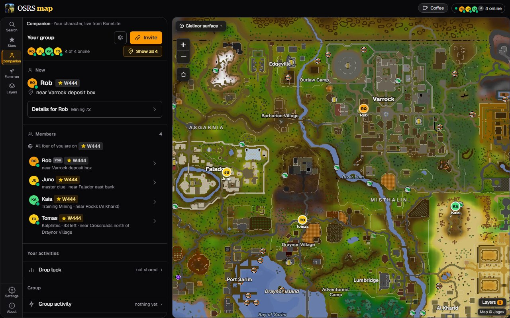
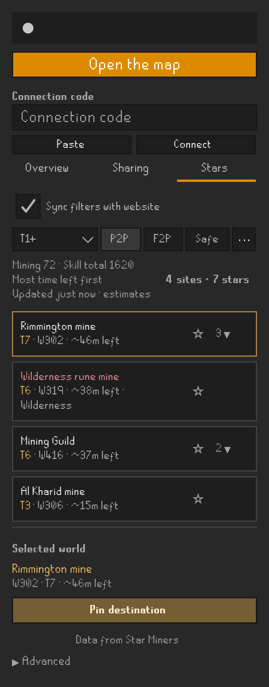
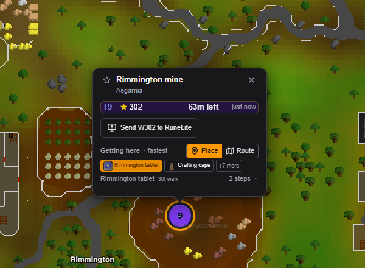

# OSRS Map Companion

Connect RuneLite to [osrs-map.com](https://osrs-map.com): follow your character on the map, plan
travel around what your account has unlocked, see shooting stars, and share a map with friends.

  

  
  
  

  
  

The pictures use made-up characters and stars.

## What it does

- **Your character on the map.** osrs-map.com follows your position, floor and world as you play.
- **A map for your group.** Friends who share their position appear on the website and, if you
  turn it on, on the game's own world map in the same colours.
- **Travel planned around your account.** The map's routes use your quests, diaries, items and
  transport unlocks, so it suggests the ways you can actually take.
- **Tasks and timers.** Your slayer task, clue step, hunter rumour, Mahogany Homes job, farming
  contract, birdhouses and the farm patches you have walked past show on the map.
- **Shooting stars.** The **Stars** tab lists active stars by site, world, tier and time left, with
  filters and favourite sites. Pin one to see it on the world map. To get to a star's world, type
  `::hop` and its world number in chat, for example `::hop 444`.
- **Drop luck.** How lucky or dry you are on the monster you are killing, in the sidebar and, if
  you want, as one chat line when a drop lands.
- **Destinations and meetups.** Places your group sends from the map appear on the world map, with
  the game's hint arrow once you are close, and a reminder before a meetup starts.

## Getting started

1. Install **OSRS Map Companion** from the Plugin Hub.
2. On osrs-map.com, open the [Companion panel](https://osrs-map.com/map?task=companion) and create
   a group, or follow a friend's invite.
3. Press **Copy connection code** on the map, then **Paste** and **Connect** in the plugin's
   sidebar.
4. Read the server notice. In the **Sharing** tab, turn on **Position and world** under
   **Map presence** to appear as a dot on the map, and choose anything else you want to share.

Nothing is shared until you choose it, and joining a group does not turn anything on. **Name to
show** sets the name your group sees, which does not have to be your character's. **Copy invite**
copies a message you can send a friend. **Switch** remembers up to eight groups.

In the plugin's settings, **Show destinations from the map**, **Show my group on the world map**
and **Notify before a meetup** start off. **Drop luck in chat** and **Point the game's arrow at a
destination** start on; neither sends anything.

## What you share

**This plugin sends data to osrs-map.com, a third-party server, which receives your IP address.**
Nothing is sent until you press **Connect** and accept the server notice. While you are connected
and logged in, the plugin sends a random member id, the name you chose and your group's
credentials, even with every sharing choice off.

Each choice in the **Sharing** tab starts off, and each can send:

- **Name and presence:** the display name of the character you are logged in as; your account type;
  your position, your world and what kind of world it is; whether you are inside an instance and
  whether that instance is one place or rooms put together; which skill you are currently training,
  recent experience and how long since you last moved.
- **Progress and travel:** skill levels; started, finished, or neither for the 49 quests that unlock
  travel; optionally the full quest and miniquest log; which achievement diary tier you have finished
  and which of those rewards you have collected; derived travel unlocks from carried/equipped items
  as yes/no flags; verified permanent transport unlocks, your house town and which STASH units you
  have built. STASH contents are not read.
- **Tasks and timers:** your current slayer task and remaining count; your active clue step
  (tier, item id, observed clue text and resolved tile); your observed hunter rumour;
  your Mahogany Homes customer and tier; the crop requested by your farming contract;
  birdhouse states and observation ages; the state of farming patches you have walked past,
  including crop, stages, observation age, estimated growth windows and witnessed replant receipts.
- **Loot:** observed loot kills for every monster, how long ago each was last killed, notable drop
  counts and observation baselines, kills since a drop, slayer-task/diary rate conditions, the
  monster currently being killed and your pinned drop. Completeness flags identify omitted history.
- **Announcements and death:** an announcement of a notable reward or a real level gained,
  with observed item name/id, quantity, NPC/activity source and optional pet/collection badge;
  the tile where you most recently died and its age. Unknown reward details remain absent.
  Large snapshots include a flag saying some of it was left out.

**Reroute**, under the steps of a destination the map sent, sends the tile you are standing on,
once per press and whatever you share, so the map can plan the way from there. The map plans with
it and does not keep it.

**Search**, at the top of Overview once you are connected, sends what you type to the map, which
answers with places and keeps nothing. Picking a result sends the tile you are standing on, as
Reroute does, so the way is planned from there.

Your chat, other players, your bank and inventory, your existing collection log slots, a complete
loot history and anything derived from your account's identifiers are never sent. **Advanced →
Show what's sent** shows what would go out right now. The server's operator and your group's
members can see what you share.

osrs-map.com keeps live positions and progress in memory only, with no movement history. Groups,
the names last shared in them, invites, meetups and group pins are kept. A group's owner can turn
on an activity feed that keeps up to 200 drop and level announcements for 14 days. See the
[privacy policy](https://osrs-map.com/privacy). **Leave group** stops sharing and deletes the
plugin's saved credentials; your kill log stays on your computer.

Shooting star data comes from Star Miners by way of osrs-map.com. The plugin never contacts Star
Miners, who do not endorse it.

## Good to know

- Drop luck counts the kills the plugin has seen on normal members worlds, not your lifetime kill
  count, and only drops with a sourced rate get odds. Activity rewards need RuneLite's
  **Loot Tracker** plugin. **Forget kill log** clears the current character's counts.
- Birdhouses need RuneLite's **Time Tracking** plugin. Farm timers are estimates; disease and later
  visits can change them.
- After logging in or hopping, check your hunter rumour with the quetzal whistle again; ask an
  estate agent to see your Mahogany Homes job again.
- **Show on map** beside a death opens that spot on osrs-map.com in your browser.

## Help and feedback

Found a bug, or have an idea? [Open an issue](https://github.com/plbolduc/osrs-map-companion/issues)
with what you did and what you expected to happen.

## Licence

BSD 2-Clause; see [LICENSE](LICENSE) and [NOTICE](NOTICE) for bundled third-party notices.
The drop rates in `src/main/resources/unique-rates.json` are transcribed from the OSRS Wiki,
CC BY-NC-SA 3.0; NOTICE names the sources of every bundled table.
