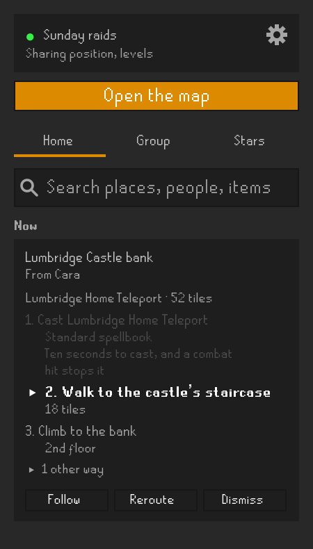
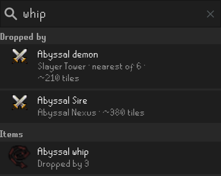
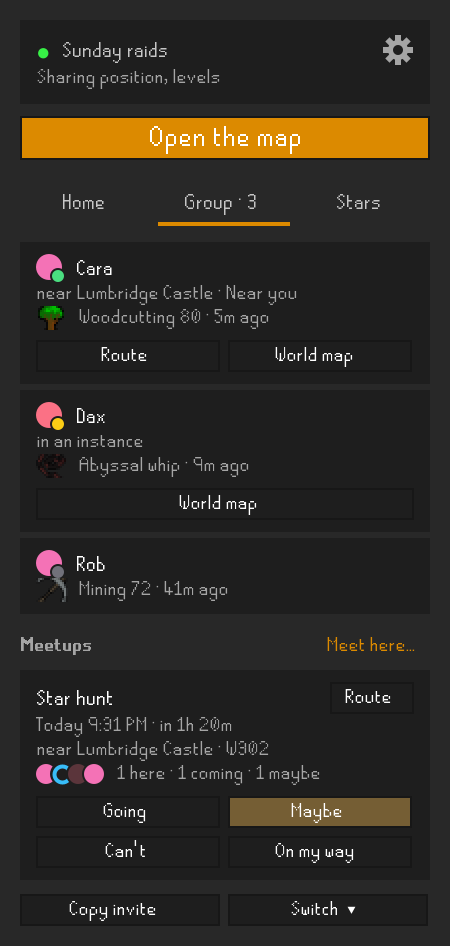
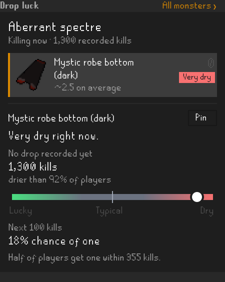
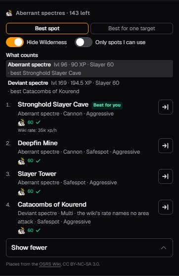
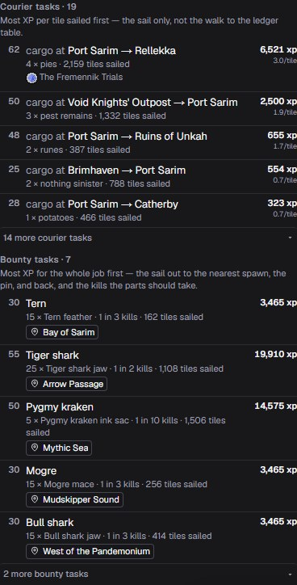
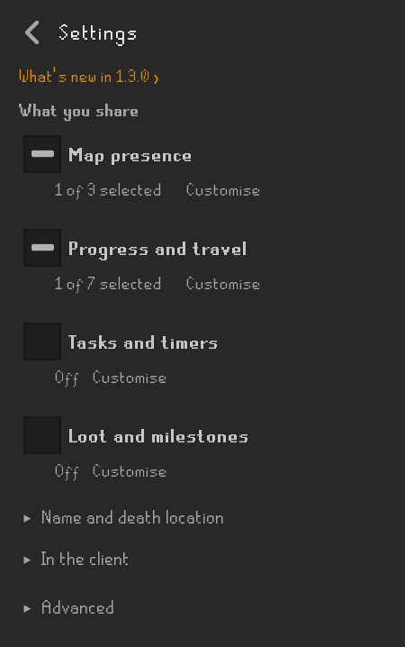

# OSRS Map Companion

Bring [osrs-map.com](https://osrs-map.com)'s routes, search and shooting stars into RuneLite,
and see your character and friends on the website.

[Getting started](#getting-started) · [Search](#search-for-a-place-or-item) ·
[Slayer](#slayer-on-the-website) · [Sailing](#sailing-on-the-website) ·
[What's new](https://osrs-map.com/whats-new)

## Routes in RuneLite

  

Send a place from the website or pick a search result, and the sidebar lists the way there.
Each step gets a numbered pin on the game's world map; the game's arrow points at the current
step when it is in the loaded area.

With **Shortest Path** installed, press **Follow** to draw each walking step as you reach it.
**Reroute** plans again from where you stand. The website uses the progress and travel choices
you share to suggest routes around your account's quests, diaries, items and transport unlocks.

You can also plan a route to a friend, a meetup or a precise star site, back to where you died,
and to coordinate clues and recognised beginner map clues.

## Search for a place or item

  

Search for banks, shops, NPCs, monsters and items from **Home**. An item can show the monsters
that drop it and the shops that sell it. Pick a place, monster or shop to plan the way there.
Results use the game's map icons and item sprites.

## Friends and meetups

  

**Group** shows your friends' locations and latest levels and drops. Friends who share
their position appear on the website and, if you enable it, on RuneLite's world map in the same
colours. **Route** plans the way to a friend's current position.

Create a meetup with **Meet here…**, see who is coming, and answer **Going**, **Maybe**, **Can't**
or **On my way**. You can turn on a reminder before it starts.

## Shooting stars

  

**Stars** lists active stars by site, world, tier and estimated time left. Filter by tier and
world type, save favourite sites, and optionally sync your filters and favourites with the website.
Pick a precise site to pin it on the world map or plan a route there.

To change worlds, type `::hop` and the world, for example `::hop 444`.

## Drop luck

  

See how lucky or dry you are on the monster you are killing, with sourced drop odds, a dry-streak
comparison and the chance over your next kills. **All monsters** opens your recorded history.
Optional chat lines report your luck when a drop lands. Drop luck also works without connecting
to the website.

## Your character on the website

The website follows your character's position, floor and world as you play. See your slayer task,
clue step, hunter rumour, Mahogany Homes job and farming contract on the map, alongside birdhouse
timers and the farm patches you have visited.

## Slayer on the website

  

Share your task to compare ranked places to do it and the other monsters that count.
See access requirements, filter out Wilderness or unusable places, and send your chosen place
to RuneLite to follow the route there.

## Sailing on the website

  

Open a port task board on osrs-map.com to compare courier and bounty jobs, their levels and XP.
Couriers are ranked by XP per sailed tile; bounties account for the sail out and back and the
expected hunting. A bounty's pin opens the creature on the map.

The pictures use made-up characters and stars.

## Getting started

1. Install **OSRS Map Companion** from the Plugin Hub.
2. On osrs-map.com, open the [Companion panel](https://osrs-map.com/map?task=companion) and create
   a group, or follow a friend's invite. You can use a group on your own.
3. Press **Copy connection code** on the map, then **Paste** and **Connect** in the plugin's
   sidebar.
4. Read the server notice. Press **Share what's ticked**, or **Customise** to choose field by
   field first, or **Not now** to share nothing yet. The gear opens **Settings** whenever you
   want to change your choices.

## What you share

**This plugin sends data to osrs-map.com, a third-party server, which receives your IP address.**
Nothing is sent until you press **Connect** and accept the server notice. While you are connected
and logged in, the plugin sends a random member id, the name you chose and your group's
credentials, even with every sharing choice off.

Full sharing details and settings

  

Every choice starts off. After the server notice, one press of **Share what's ticked** turns on
everything below except where you died, and draws destinations, meetups and your group on the
world map, which keeps one connection open to the map while you are logged in. Nothing is turned
on until you press, and you can untick any of it first. Each choice can send:

- **Name and presence:** the display name of the character you are logged in as; your account type;
  your position, your world and what kind of world it is; whether you are inside an instance and
  whether that instance is one place or rooms put together; which skill you are currently training,
  recent experience and how long since you last moved.
- **Progress and travel:** skill levels; started, finished, or neither for the 49 quests that unlock
  travel; optionally the full quest and miniquest log; which achievement diary tier you have finished
  and which of those rewards you have collected; derived travel unlocks from carried/equipped items
  as yes/no flags; verified permanent transport unlocks, your house town and which STASH units you
  have built. STASH contents are not read.
- **Tasks and timers:** your current slayer task and remaining count; your active clue step
  (tier, item id, observed clue text and resolved tile); your observed hunter rumour;
  your Mahogany Homes customer and tier; the crop requested by your farming contract;
  birdhouse states and observation ages; the state of farming patches you have walked past,
  including crop, stages, observation age, estimated growth windows and witnessed replant receipts.
- **Loot:** observed loot kills for every monster, how long ago each was last killed, notable drop
  counts and observation baselines, kills since a drop, slayer-task/diary rate conditions, the
  monster currently being killed and your pinned drop. Completeness flags identify omitted history.
- **Announcements and death:** an announcement of a notable reward or a real level gained,
  with observed item name/id, quantity, NPC/activity source and optional pet/collection badge;
  the tile where you most recently died and its age. Unknown reward details remain absent.
  Large snapshots include a flag saying some of it was left out.

**Reroute**, under the steps of a destination the map sent, sends the tile you are standing on,
once per press and whatever you share, so the map can plan the way from there. The map plans with
it and does not keep it.

**Search**, at the top of Home once you are connected, sends what you type to the map, which
answers with places and keeps nothing. Picking a result sends the tile you are standing on, as
Reroute does, so the way is planned from there.

**Route**, beside your clue, your last death, a star or a meetup, sends the tile you are standing on
and the tile it goes to, once per press. That includes your clue's tile and where you died when you
do not share them: they leave in that one request and the map plans with them and keeps neither.
Your clue is read in this client whether or not you share it, so the sidebar can offer Route.

**Meet here** sends the title and time you choose, the tile you are standing on and your world,
once per press, to make a meetup your group can see. Answering a meetup (**Going**, **Maybe**,
**Can't** or **On my way**) sends that answer, once per press. Nothing answers for
you: Route to a meetup tells nobody you are coming.

Your chat, other players, your bank and inventory, your existing collection log slots, a complete
loot history and anything derived from your account's identifiers are never sent. **Settings →
Advanced → Show what's sent** shows what would go out right now. The server's operator and your group's
members can see what you share.

osrs-map.com keeps live positions and progress in memory only, with no movement history. Groups,
the names last shared in them, invites, meetups and group pins are kept. A new group keeps two
weeks of its members' notable drops, levels, quests and diaries, up to 200 entries; its owner can
turn this off. See the [privacy policy](https://osrs-map.com/privacy). **Leave group** stops
sharing and deletes the plugin's saved credentials; your kill log stays on your computer.

Shooting star data comes from Star Miners by way of osrs-map.com. The plugin never contacts Star
Miners, who do not endorse it.

Nothing is shared until you choose it, and joining a group does not turn anything on. With
**Character name** ticked your group sees it; untick it and **Name to show instead** sets what they
see, or Member if you leave it empty. **Copy invite** copies a message you can send a friend.
**Switch** remembers up to eight groups, and joins another.

In the plugin's settings, **Show destinations from the map**, **Show my group on the world map**
and **Notify before a meetup** start off; the step after Connect ticks the first two for you to
confirm. **Drop luck in chat** and **Point the game's arrow at a destination** start on; neither
sends anything.

## Good to know

- Drop luck counts the kills the plugin has seen on normal members worlds, not your lifetime kill
  count, and only drops with a sourced rate get odds. Activity rewards need RuneLite's
  **Loot Tracker** plugin. **Forget kill log** clears the current character's counts.
- Birdhouses need RuneLite's **Time Tracking** plugin. Farm timers are estimates; disease and later
  visits can change them.
- After logging in or hopping, check your hunter rumour with the quetzal whistle again; ask an
  estate agent to see your Mahogany Homes job again.
- **Open website** beside a death, or beside a star whose spot is approximate, opens it on
  osrs-map.com in your browser. **World map** beside a friend draws them on the game's own map.

## Help and feedback

Found a bug, or have an idea? [Open an issue](https://github.com/plbolduc/osrs-map-companion/issues)
with what you did and what you expected to happen.

## Licence

BSD 2-Clause; see [LICENSE](LICENSE) and [NOTICE](NOTICE) for bundled third-party notices.
The drop rates in `src/main/resources/unique-rates.json` are transcribed from the OSRS Wiki,
CC BY-NC-SA 3.0; NOTICE names the sources of every bundled table.
