# OSRS Map Companion

Where to go for what you are doing, and the fastest way there, teleports included. A drop, your
Slayer task, a clue, a farm run, a Sailing port task, a shooting star or a friend becomes numbered
steps in your sidebar, planned around what your account can use. [osrs-map.com](https://osrs-map.com)
plans the journey; [Shortest Path](https://github.com/Skretzo/shortest-path) draws each walk.

Play with friends too: see where they are and what they are doing, from levels and drops to
quests, route to them, and plan meetups.

[Getting started](#getting-started) · [Search](#search-for-a-place-or-item) ·
[Slayer](#slayer-in-runelite) · [Farm runs](#farm-runs-in-runelite) · [Sailing](#sailing) ·
[What's new](https://osrs-map.com/whats-new)

## Routes in RuneLite

  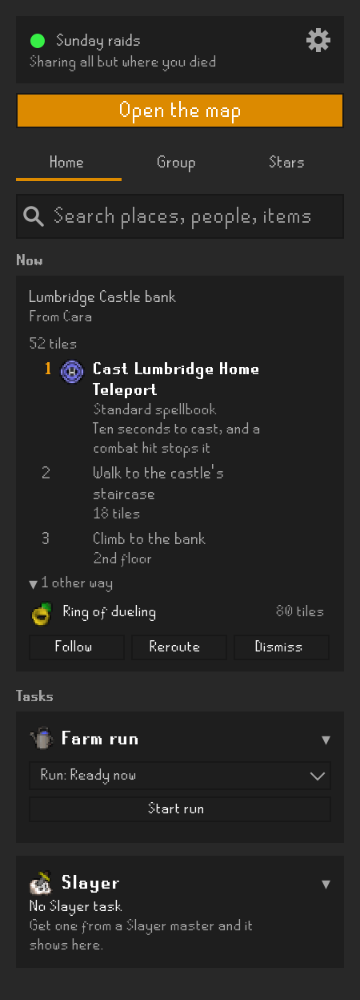

Pick a place, a search result or a task, and the sidebar lists the way there step by step: which
teleport to use, which ride to take, where to walk. A teleport step shows the item or spell, and
outlines it in your inventory or spellbook while you follow. Each step gets a numbered pin on the
game's world map, and you can right-click that map and choose **Route here** to go anywhere.

Press **Follow** to keep the step you are on in a small box over the game. **Reroute** plans
again from where you stand. Share **Progress and travel** and routes use only the quests,
diaries, items and unlocks your account has.

**Works with Shortest Path.** Map Companion tells you where to go and which teleport to use;
Shortest Path draws the walks.

  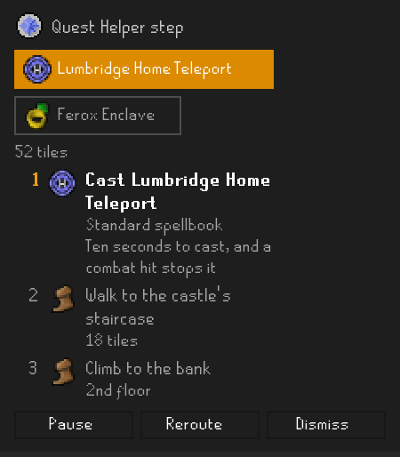

**Works with Quest Helper.** With Quest Helper's *Use 'Shortest Path' plugin* setting on, Home shows
your current quest step, and **Route** plans the way there, teleports included. A path handed to
Shortest Path does not say which plugin sent it, so another plugin's path can show its tile there instead.

## Search for a place or item

  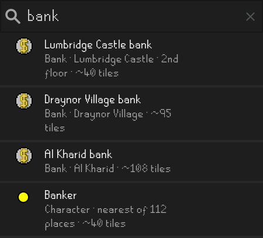

Search banks, shops, NPCs, monsters and items from **Home**. An item shows the monsters that drop
it and the shops that sell it; pick one to plan the way there.

## Slayer in RuneLite

  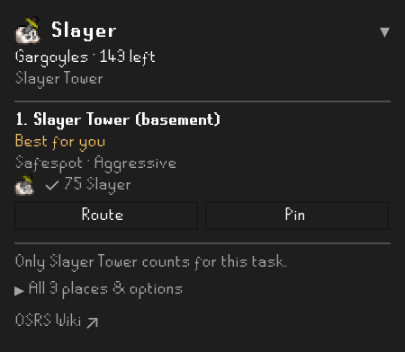

Home ranks the places to do your Slayer task, keeps the ones you cannot use yet with what they
need, and counts your kills. Press a place's name to open it, and **Route** takes you there.
The Farm run, Slayer and Port tasks cards each fold away under their heading.

## Farm runs in RuneLite

  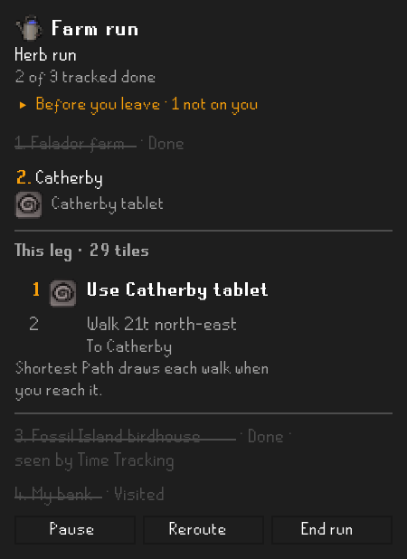

Start a run from **Ready now**, **Birdhouses** or your farming contract, or build one on the
website. The sidebar lists each stop and the way to it, checks in the bank which teleports you
are missing, and ticks a stop off once you have replanted it.
**Dailies run** visits every daily your diaries and quests allow, leaving out what you have
collected today when **Dailies collected** is on.

  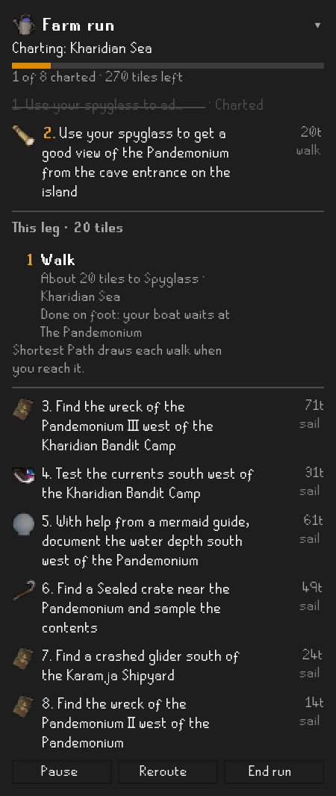

**Sea charting run** sails your boat through the nearest seas you have not charted, docking where a
task is done on foot, and ticks each task as the game charts it; it needs **Sea charts charted** on.

## Sailing

  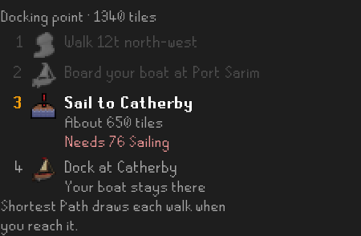

A voyage in your own boat is its own steps, board, sail and dock, starting where your boat is.
They tick off as you go, and the sail is drawn on the world map. Each of your boats is pinned on
the world map at the port where it is moored, with nothing sent and no Connect needed.

  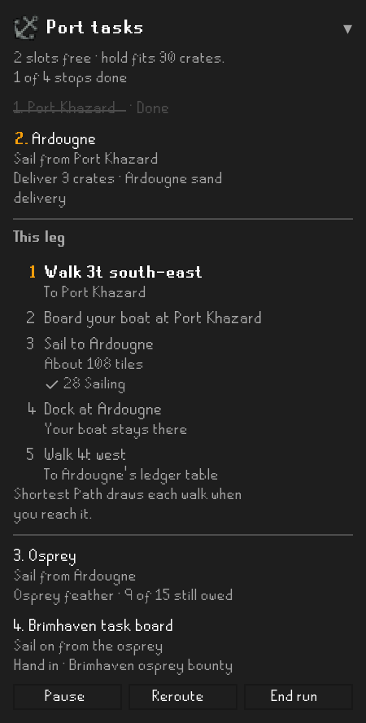

Home lists the port tasks you hold, and **Start run** turns them into one trip: every crate in the
order your hold allows, then each bounty out to its creature and back.

## Shooting stars

  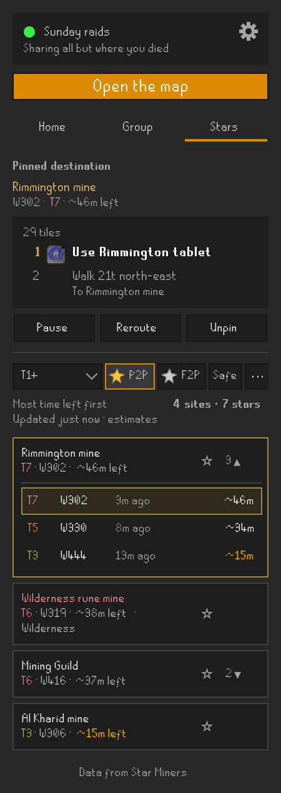

**Stars** lists active stars by site, world, tier and time left, with a star on the world you
are on marked in green. Filter them, save favourite sites, and press one to route to it; its steps
stay at the top of the tab while you hop, and the pin clears itself when you get there. On a
Hardcore or League world it lists that game's stars instead.

## Friends and meetups

  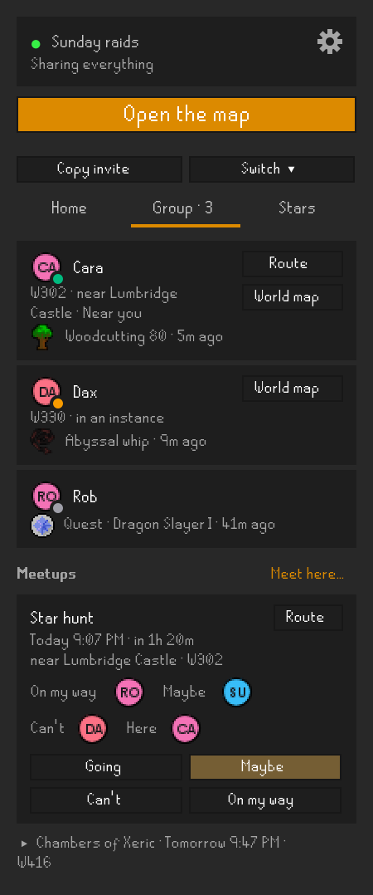

**Group** shows where your friends are and their latest levels, drops, quests and diaries.
**Route** takes you to a friend. **Meet here…** sets a meetup everyone can answer: Going, Maybe,
Can't or On my way.

## On osrs-map.com

  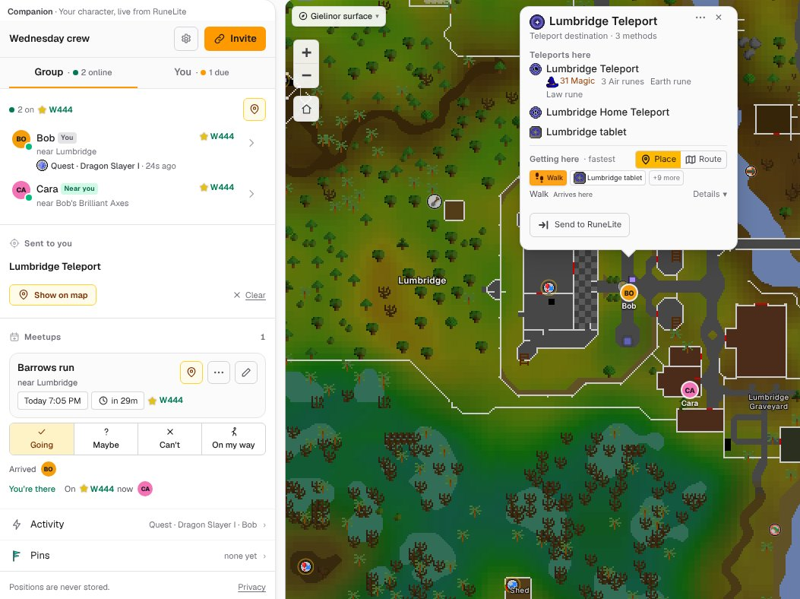

**Open the map** opens the website as you, for a bigger map on another screen: you and your
friends as you play, your meetups, and your task, clue, farm patches and birdhouses.

  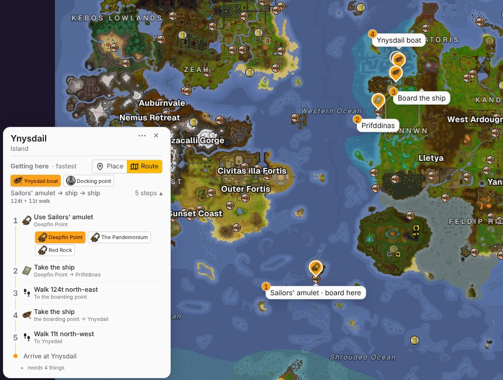

Any place on the map has its fastest ways there, teleports and rides included, drawn as numbered
pins. **Send to RuneLite** puts the route in your sidebar.

  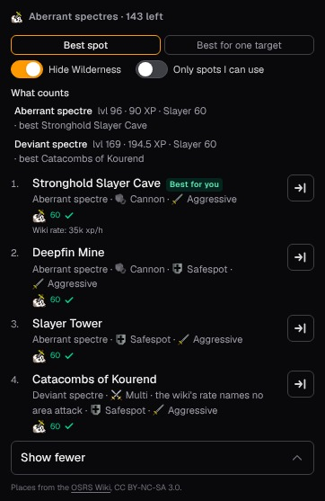
  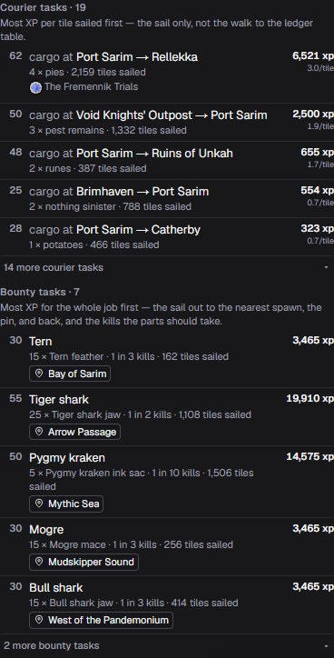

Compare every place for your Slayer task, or a port's courier and bounty jobs, and send the one you
pick to RuneLite. What the plugin reads from your game fills the website in as you play: Mortimer's
offer ranked as soon as you open it, the sea charts you have charted marked on the map, and the
dailies you have collected left out of a dailies run.

## Drop luck

  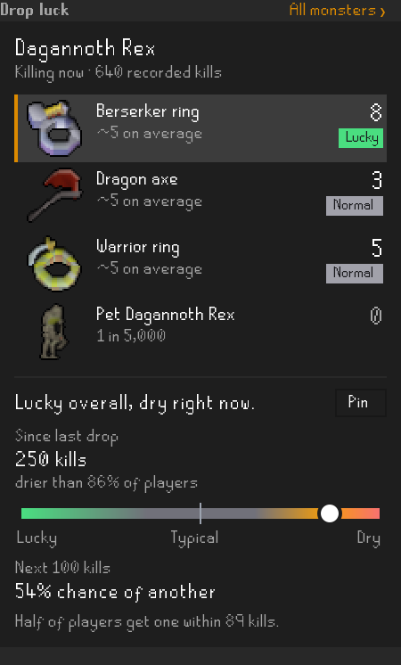

See how lucky or dry you are on the monster you are killing, with sourced drop odds and the chance
over your next kills. It works without connecting to the website.

Every control and rule, feature by feature, is in [docs/features.md](docs/features.md). The
pictures use made-up characters and stars.

## Getting started

1. Install **OSRS Map Companion** from the Plugin Hub and open its sidebar.
2. Press **Connect**. The plugin makes a group for you, called *Our group*; you can use it on your
   own, and rename it with **Rename group…** under its name, or **Switch ▾ → Rename group…** under
   **Group**.
3. Press **Share what's ticked**, or untick what you would rather keep to yourself first, or
   **Not now** to share nothing yet. The gear opens **Settings** whenever you want to change your choices.
4. To play with friends, press **Copy invite** under **Group** and send it. A friend copies it and
   presses **Paste** under **Have an invite?** in their own sidebar, which joins your group.

**Open the map** opens osrs-map.com already in your group, as you, for the bigger map on another
screen. A group made on the website joins the same way: paste its invite, or the connection code
from its Companion panel.

## What you share

**This plugin sends data to osrs-map.com, a third-party server, which receives your IP address.**
Nothing is sent until you press **Connect**. While you are connected and logged in, the plugin
sends a random member id, the name you chose and your group's credentials, even with every
sharing choice off.

Full sharing details and settings

  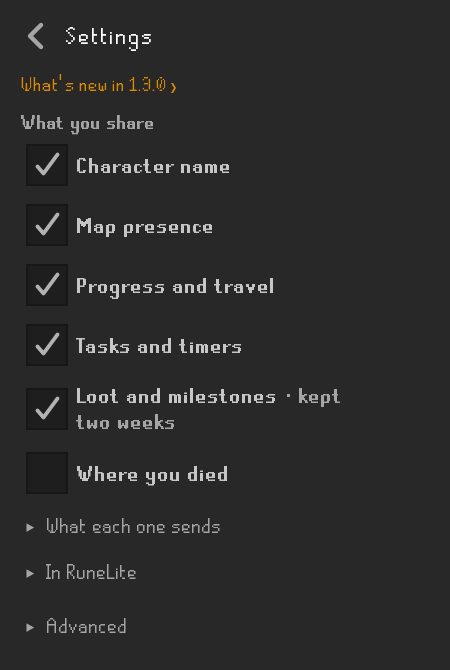

Sharing is six switches, and every one starts off. After your first Connect, one press of
**Share what's ticked** turns on all of them except **Where you died**, and draws destinations,
meetups and your group on the world map, which keeps one connection open to the map while you are
logged in. Nothing is turned on until you press, and you can untick any of them first. A switch
turns on, or off, everything it can send:

- **Character name:** the display name of the character you are logged in as.
- **Map presence:** your position, your world and what kind of world it is; whether you are inside
  an instance and whether that instance is one place or rooms put together; which skill you are
  currently training, recent experience and how long since you last moved; your account type.
- **Progress and travel:** skill levels; started, finished, or neither for the 49 quests that unlock
  travel; optionally the full quest and miniquest log; which achievement diary tier you have finished
  and which of those rewards you have collected; derived travel unlocks from carried/equipped items
  as yes/no flags; verified permanent transport unlocks, your house town and which STASH units you
  have built; where each of your boats is moored and whether it carries a teleport focus, so the
  map's voyages start at your boat; and which Sailing sea charting tasks you have charted. STASH
  contents are not read, and boat names are not sent.
- **Tasks and timers:** your current slayer task and remaining count; with no task, the tasks Mortimer offers while you choose, each with its mortifier; your active clue step
  (tier, item id, observed clue text and resolved tile); your observed hunter rumour;
  your Mahogany Homes customer and tier; the crop requested by your farming contract and whether
  it is ready to hand in;
  birdhouse states and observation ages; the state of farming patches you have walked past,
  including crop, stages, observation age, estimated growth windows and witnessed replant receipts
  for the 99 patches supported by RuneLite's crop tracker (including grapes, coral and seaweed);
  which Sailing port task each of your five slots holds, with crates collected and delivered or
  bounty parts still owed, and whether a slot is empty, locked or unreadable; how many crates
  the cargo hold of the boat you last stood on carries, though cargo is not read; and which of the
  dailies the map plans you have collected today.
  With your Slayer task, the Slayer list's order, Wilderness filter and delivery receipt. These
  request your own sidebar list through the existing connection. They add no poll.
- **Loot and milestones:** observed loot kills for every monster, how long ago each was last killed,
  notable drop counts and observation baselines, kills since a drop, slayer-task/diary rate
  conditions, the monster currently being killed and your pinned drop. Completeness flags identify
  omitted history. It also sends an announcement of a notable reward, a real level gained, or a quest or
  achievement diary tier finished while the plugin watched, with observed item name/id, quantity,
  NPC/activity source and optional pet/collection badge, or the quest's name or the diary's region
  and tier. A quest or diary is announced only when **Progress and travel** is shared too, and never
  for what was done before the plugin was watching. Unknown reward details remain absent.
- **Where you died:** the tile where you most recently died and its age.

Large snapshots include a flag saying some of it was left out.

**Connect**, with no group yet, sends a random key for this RuneLite, once per press; the map makes
your group with it. **Join** with a pasted invite, or **Connect** with one in the field, sends that
key and the invite. Neither sends
anything about your character. If you have changed **Settings → Advanced → Map address** to a server
other than osrs-map.com, the first Connect to it asks you first, naming it.
**Open the map** sends your group's credentials once per press, and opens a one-time link that
adds that browser to your group as you. **Rename group…** sends the new name, once per press, and
**Remove from group…** sends which friend to remove, once per press.

**Reroute**, under the steps of a destination the map sent, sends the tile you are standing on,
once per press and whatever you share, so the map can plan the way from there. The map plans with
it and does not keep it.

**Search**, at the top of Home once you are connected, sends what you type to the map, which
answers with places and keeps nothing. Picking a result sends the tile you are standing on, as
Reroute does, so the way is planned from there.

**Route**, beside your clue, your last death, your Quest Helper step, a star or a meetup, sends the
tile you are standing on and the tile it goes to, once per press, as does **Route** on a destination
that has no way yet.
That includes your clue's tile and where you died when you do not share them: they leave in that
one request and the map plans with them and keeps neither.
For a clue step that is words, or a map above beginner, Route sends the clue instead, its tier, any
words and its scroll, the same way. Your clue is read in this client whether or not you share it, so
the sidebar can offer Route.

**Start run** sends your chosen run kind and the tile you stand on, once per press, even with
position sharing off. A run's **Reroute** also sends its id and which numbered stops are
done or visited. **End run** asks the map to remove your run. The map keeps the itinerary in
memory for up to three hours. While a run is active, patch replants and carried travel items
are read locally even with farming or item sharing off; only your enabled sharing choices
put readings in snapshots. The bank checklist's local item check sends nothing.
Enabling **Destinations and meetups** also tells the website this build can receive a
farm run, so it offers **Send run** only to a compatible live client of your own.

**Meet here** sends the title and time you choose, the tile you are standing on and your world,
once per press, to make a meetup your group can see. Answering a meetup (**Going**, **Maybe**,
**Can't** or **On my way**) sends that answer, once per press. Nothing answers for
you: Route to a meetup tells nobody you are coming.

Your chat, other players, your bank and inventory, your existing collection log slots, a complete
loot history and anything derived from your account's identifiers are never sent. **Settings →
Advanced → Show what's sent** shows what would go out right now. The server's operator and your group's
members can see what you share.

osrs-map.com keeps live positions and progress in memory only, with no movement history. Groups,
the names last shared in them, invites, meetups and group pins are kept. A new group keeps two
weeks of its members' notable drops, levels, quests and diaries, up to 200 entries; its owner can
turn this off. See the [privacy policy](https://osrs-map.com/privacy). **Leave group** stops
sharing, deletes the plugin's saved credentials and forgets any other group you would need a new
invite to rejoin; your kill log stays on your computer.

Shooting star data comes from Star Miners by way of osrs-map.com. The plugin never contacts Star
Miners, who do not endorse it.

Nothing is shared until you choose it, and joining a group does not turn anything on. With
**Character name** ticked your group sees it; untick it and **Name to show instead** sets what they
see, or Member if you leave it empty. **Copy invite** copies a message you can send a friend.
**Switch** remembers up to eight groups, and joins another; the person who made the group can
rename it there, and remove a friend by right-clicking them under **Group**.

Under **In RuneLite**, **Destinations and meetups**, **Group on the world map** and **Meetup reminder**
start off; the step after Connect ticks the first two for you to confirm. **Drop luck in chat**,
**Your boats on the world map**, **Hint arrow to a destination**, **Step on screen**, **Step's
teleport outlined**, **Draw paths with Shortest Path** and **Farm run teleports in the bank** start
on; none of them sends anything.
**Route here on the world map** starts on too, and sends only when you choose it. The keys for
Reroute and Follow, and how many minutes before a meetup the reminder comes, are in RuneLite's own
settings for the plugin.

## Good to know

- Drop luck counts the kills the plugin has seen on normal members worlds, not your lifetime kill
  count, and only drops with a sourced rate get odds. Activity rewards need RuneLite's
  **Loot Tracker** plugin. **Forget kill log** clears the current character's counts.
- Birdhouses need RuneLite's **Time Tracking** plugin. Farm timers are estimates; disease and later
  visits can change them.
- After logging in or hopping, check your hunter rumour with the quetzal whistle again; ask an
  estate agent to see your Mahogany Homes job again.
- **Open website** beside a death, or beside a star whose spot is approximate, opens it on
  osrs-map.com in your browser. **World map** beside a friend draws them on the game's own map.

## Help and feedback

Found a bug, or have an idea? [Open an issue](https://github.com/plbolduc/osrs-map-companion/issues)
with what you did and what you expected to happen.

## Licence

BSD 2-Clause; see [LICENSE](LICENSE) and [NOTICE](NOTICE) for bundled third-party notices.
The drop rates in `src/main/resources/unique-rates.json` are transcribed from the OSRS Wiki,
CC BY-NC-SA 3.0; NOTICE names the sources of every bundled table.
