# The sidebar says its status first and puts one action in front

Status: **built**, on the branch of the same name. This is item 11 of a review of every surface
the map and this plugin draw; the whole review, its method and its other ten items are
`docs/plan-compact-pass.md` in `osrs-stars-map`, on the branch of the same name. The proposal is
kept below as it was written, under *The proposal*; what changed on the way comes first.

## As built

The real `MapCompanionPanel`, both sides of the change, wired through the harness's own
collaborators and painted with RuneLite 1.12.39's `RuneLiteLAF` into the 225px column — not a
transcription this time. The paired state is the proposal's: a destination with the hop setting
on, a meetup, a death seven minutes ago, 1,300 kills dry on a 1/512 drop, name and death spot
switched off, two remembered groups.

| | Before | After |
| --- | --- | --- |
| Paired, busy | 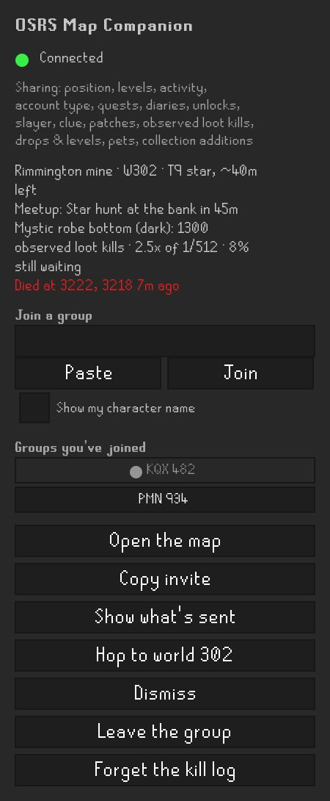 | 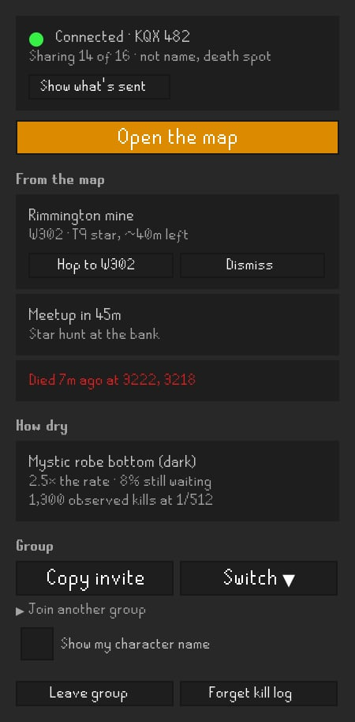 |
| Paired, nothing from the map | 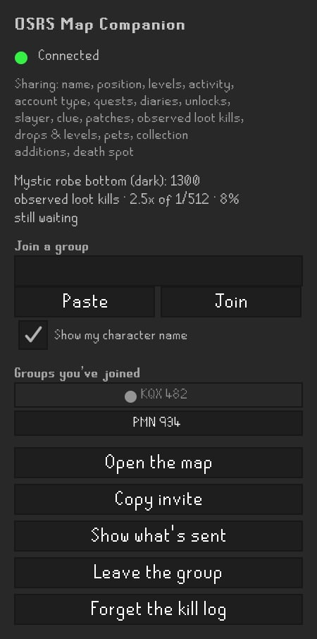 | 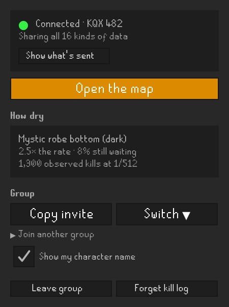 |
| No group yet, with a kill log | 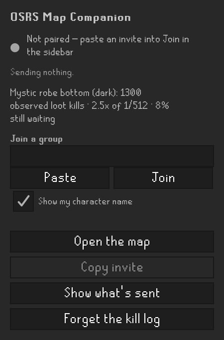 | 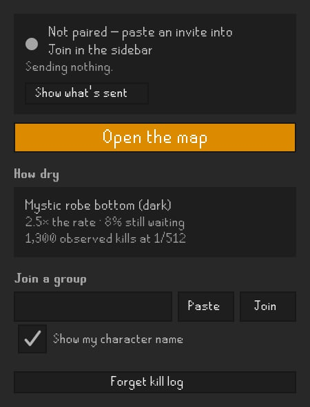 |
| A fresh install, nothing at all | 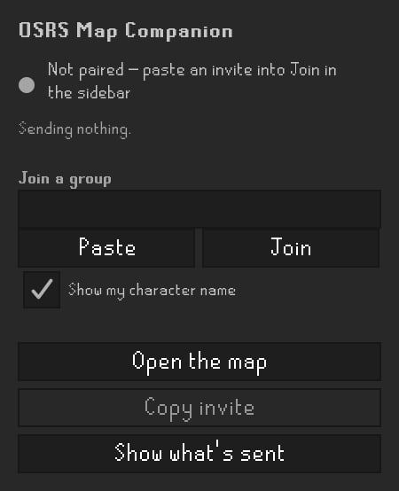 | 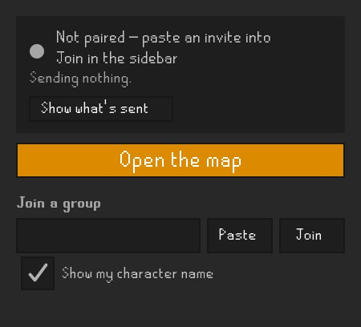 |

| State | Before | After |
| --- | --- | --- |
| Paired, busy, hop on | 545px | 457px |
| Paired, busy, hop off (the default) | 519px | 457px |
| Paired, nothing from the map | 453px | 301px |
| No group yet, with a kill log | 342px | 296px |
| A fresh install, nothing at all | 277px | 204px |

The transcription the proposal was drawn from held up: its "before" measured 544px for the busy
state, and the real panel measures 545. Its fresh install had a kill log in it, which is the
second-to-last row here; the last is what somebody who has only just installed it sees. Hop and
Dismiss sharing a row inside the destination's card is why the after costs the same with the hop
setting on or off; before, Hop was one more full-width button at the foot.

The renderer is `docs/review-evidence/compact-pass-2026-09-25/plugin/RealPanelShot.java` in
`osrs-stars-map`, beside the transcription it replaces, with how to run it against either side of
the change.

## Where the plan was wrong

- **How dry is three lines, not two.** The mock's *Draconic visage · 2.5× the rate* fitted; the
  first real item tried, *Mystic robe bottom (dark) · 2.5× the rate*, broke before "rate" at the
  195px the card leaves for text. So the item has a line to itself, then *2.5× the rate · 8% still
  waiting* — the multiple still never without the share — then *1,300 observed kills at 1/512*.
  `LootLog.driest()` returns the numbers as a value for this, and the one-line `driestLine()` it
  replaces is gone rather than kept with no caller. The busy state is 457px rather than the mock's
  441 and the unpaired one 296 rather than 283, and about 12px of each is that third line. Both
  sides of the table carry the same item, so it compares like with like.
- **Two words each, everywhere they are named.** *Leave group* and *Forget kill log* are short so
  they sit side by side, and the confirm dialog's button, the README, the Hub submission notes and
  `MemberSecretTest`'s assertion on the README now name them as they are printed. A button a
  document calls something else is a button a reader cannot find.
- **The remembered groups are a menu even before a group.** With groups remembered and none
  joined, the button reads *Your groups ▾* rather than *Switch ▾*, because there is nothing to
  switch from yet. The README said switching back was one press; it is one pick from a menu now,
  and says so.
- **The sharing line says "the line", not "the sentence".** The README and the Hub notes both
  described a sentence listing every kind; they now describe the count, what is switched off, and
  the full list on hover.

## The proposal

### The complaint

`MapCompanionPanel`'s own docblock calls **Open the map** "the one button that matters", and
the panel draws it after everything else: below the status lines, the join field, the list of
remembered groups, and then as the first of up to seven identical full-width buttons
(`syncButtons`, `MapCompanionPanel.java:608`). The status is a sentence beside a dot; what is
being sent is a sixteen-item sentence in 11px grey; a destination, a meetup, a dry streak and a
death are four loose lines, while the two buttons that act on the destination — **Hop to world
302** and **Dismiss** — are five rows further down among the ones that erase things.

### What it said

| | Before | After |
| --- | --- | --- |
| Paired, with a destination, a meetup, a death and a dry streak | 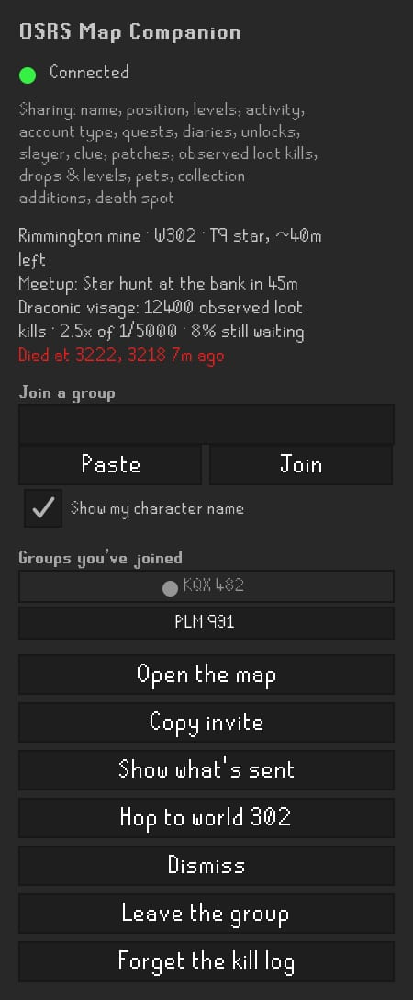 | 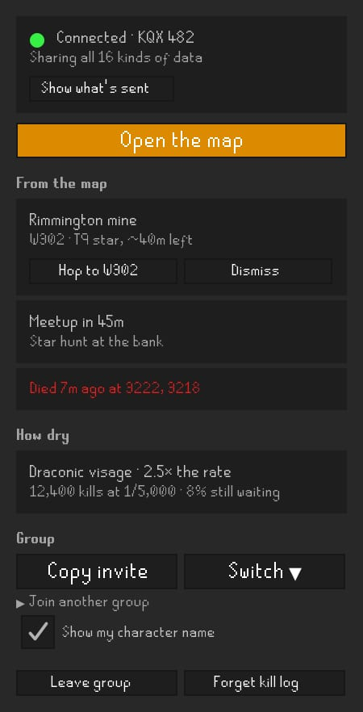 |
| A fresh install, no group | 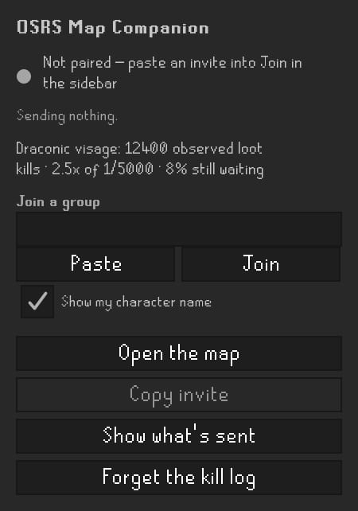 | 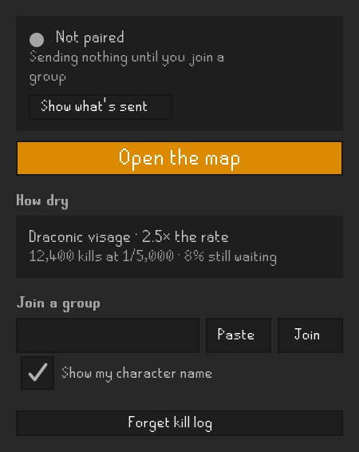 |

- **A status card first.** The dot, *Connected · KQX 482*, and *Sharing all 16 kinds of data*
  with **Show what's sent** beside it. The sixteen names move to that line's tooltip and to the
  window the button opens, which prints the snapshot itself; when something is switched off the
  line names what — *Sharing 14 of 16 · not name, death spot* — which says more than the full
  list did, because the full list is the default.
- **Open the map** as the one filled button, in `ColorScheme.BRAND_ORANGE`.
- **What the map asked for**, as cards, each holding its own action: the destination with **Hop
  to W302** and **Dismiss**, the meetup, the death.
- **How dry** in two lines with separators — *Draconic visage · 2.5× the rate* over *12,400
  kills at 1/5,000 · 8% still waiting* — rather than one line with `12400` and `1/5000`.
- **Group**: **Copy invite** and **Switch ▾**, the remembered codes as a menu instead of a
  column of buttons. Once paired, the join field folds behind *Join another group*, since
  `buildJoinBlock`'s docblock already says it is used twice.
- **Leave group** and **Forget kill log** side by side at the foot, quiet, because both erase
  something and neither is a thing a player does every session.

The panel title is dropped in the mock, because RuneLite's sidebar tab already names the
plugin; keeping it costs one row. Measured in the 225px column: 544px becomes 441 paired, and
321 becomes 283 on a fresh install.

### How the pictures were made

A Swing sidebar has no DOM to rewrite, so the "before" is `MapCompanionPanel`'s constructor
transcribed component for component — the same BoxLayout, the 8px gaps, the font sizes, the
colours, the 195px wrapped-label width, the button grid — beside the proposal, both painted with
RuneLite 1.12.39's own `RuneLiteLAF` and RuneScape fonts under `xvfb-run`. The renderer is
`docs/review-evidence/compact-pass-2026-09-25/plugin/PanelShot.java` in `osrs-stars-map`. The
state it fills in is written by hand, so the "before" is a transcription rather than a
photograph of a running client: worth one look in a real client before anything is built.

### Not in this proposal

- **Group names.** The remembered list shows codes (`● KQX 482`, `PLM 931`) because codes are
  all this installation stores; the map knows each group's name. Sending the name down with the
  snapshot reply would let the menu say *Sunday raids*. That is a relay field, not layout.
  *Built after, and described in* **Group names, built after** *below.*
- **The network behaviour.** Nothing here changes what is sent, when, or to whom; the README's
  *Network disclosure* stays exactly as written.

## Group names, built after

The menu under **Switch** says each group's name beside its code now:

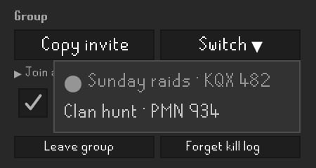

- **The map sends it.** `groupName` rides on the reply to every accepted post, beside
  `memberSecret`, and only on an accepted one — a stranger and a removed member are refused before
  it is read, and a legacy group has no name to send. It is repeated rather than sent once so a
  rename reaches somebody who was offline when it happened.
- **The plugin keeps the last one.** Filed on the game tick under the code the post was made under,
  as the secret is, and written only when it differs: it arrives every couple of seconds, and every
  config write raises a `ConfigChanged`. Absent means *keep what you have*. The names are bounded by
  the remembered list, and forgetting or leaving a group forgets its name.
- **It is shown as words.** A Swing menu item renders any text starting with `<html>` as markup,
  and a name is whatever the group's owner typed on the map, so each row is built with Swing's
  `html.disable` switch set before its text. `GroupNameTest` checks a plain item *would* have
  built markup from the same words, so the test fails if the switch stops being what prevents it.
- **The menu opens into the sidebar.** Names made it wider than the button, and hung from the
  button's left edge it ran off the sidebar's right side; it hangs from the right edge now.
- **An adopted legacy group** is named after its own code until its owner renames it, and says its
  code once rather than twice.

The picture is the real panel with its own Switch menu pressed open, painted by
`RealPanelShot.java` in `osrs-stars-map`'s evidence folder; `lib/plugin-contract.test.ts` there
checks that the route sends the key under the name `RelayResponse` declares.

## One loud button, the group's name, and times people use

Status: **built**, on `claude/ui-polish-suggestions-o0hn85` here and in `osrs-stars-map`. It is the
one item for this plugin in a polish pass over both; the pass and its other fifteen items are
`docs/plan-ui-polish-pass.md` in `osrs-stars-map`.

| | Before | After |
| --- | --- | --- |
| Paired, busy: a destination, a meetup tomorrow on W444, a death seven minutes ago | 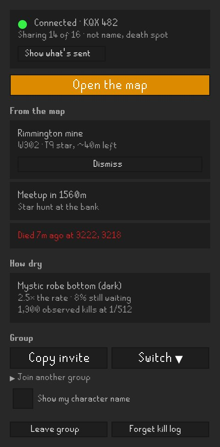 | 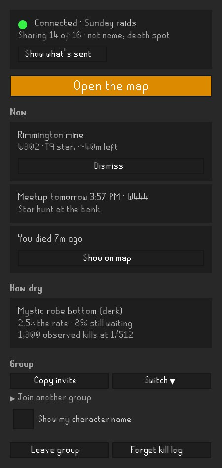 |
| No group yet | 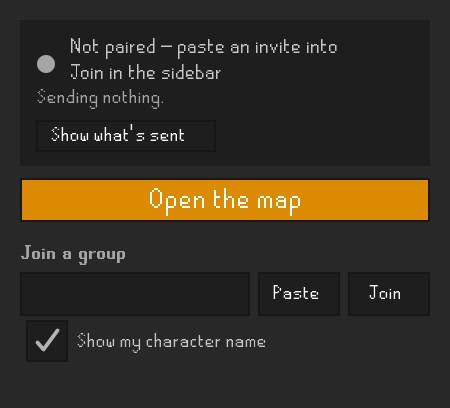 | 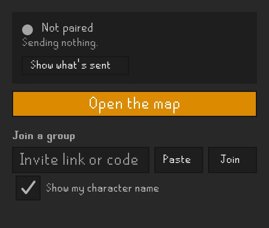 |

| State | Before | As mocked | As built |
| --- | --- | --- | --- |
| Paired, busy | 457px | 473px | 473px |
| No group yet | 204px | 191px | 191px |

- **One loud button.** *Copy invite* and *Switch ▾* were at the default font, as large as **Open
  the map**, so its colour was all that marked it as the one to press. They are small buttons now,
  like every other button that is not it.
- **The group's name on the status line.** *Connected · Sunday raids* once the map has sent a name,
  the code as the line's tooltip, and the code on the line for a group the map has not named. The
  Switch menu still prints both.
- **Meetup times people use.** *Meetup in 1560m* is *Meetup tomorrow 6:42 AM · W444*: minutes under
  an hour and hours and minutes under twelve, as the map's own meetup card counts down, then a day
  and a clock in the player's zone — *today*, *tomorrow*, a weekday within the week and a date past
  it. The world is the one the directive already carried.
- **A death in plain words.** *Died 7m ago at 3222, 3218* in red is *You died 7m ago* in the card's
  ordinary ink, the tile in the tooltip, and **Show on map**, which opens `/map?p=x,y,plane` — the map's
  own grammar for a pinned tile and floor — so its card offers the way back. It is offered whether or not the
  death spot is shared: the tile goes only in the address of the page the press opens, and the
  button's tooltip says so when sharing is off. The heading over the three cards is *Now*, because
  the death is this client's own observation and *From the map* named only two of them.
- **Unpaired, said once.** *Not paired — paste an invite into Join in the sidebar* sat directly
  above the field it pointed at. The status says *Not paired*, and the field says *Invite link or
  code* until something is typed in it.

### Where the plan was wrong

- **The floor.** The mock's tooltip read *3222, 3218, floor 0* for every death. The line now says
  *on floor 1* only when the tile is upstairs, and the tooltip *3222, 3218 (floor 1)*, which is
  what the map's own panel says about the same death.
- **The clock.** The mock wrote *h:mm a* for everybody. The clock follows the player's locale
  between twelve and twenty-four hours, but from a plain pattern rather than the locale's own:
  Java's English short time puts a narrow no-break space before *AM* on a current JDK, and the
  sidebar's font would draw it as a box. `SidebarWordsTest` checks the characters.
- **Later today, and more than a week out.** The mock knew *tomorrow* and weekdays. A meetup twelve
  hours off can be later the same day, which says *today*, and a weekday past six days could be
  either of two weeks, so that is a date.

The pictures are the real panel painted with RuneLite 1.12.39's look and feel, by
`docs/review-evidence/ui-polish-2026-09-30/plugin/PolishShot.java` in `osrs-stars-map`; the
*before* column is the same renderer run on the parent commit.

## Overview and grouped sharing, 11 October 2026

Status: **built**. Overview holds Now, Drop luck — which replaced How dry while this was being
built — and group actions; Sharing holds the existing individual opt-ins behind four group
shortcuts. The connection field sits above both
views when needed. Advanced holds the map address, the snapshot preview and the reset actions.

| Overview | Sharing | Customise | In the client | Advanced |
| --- | --- | --- | --- | --- |
| 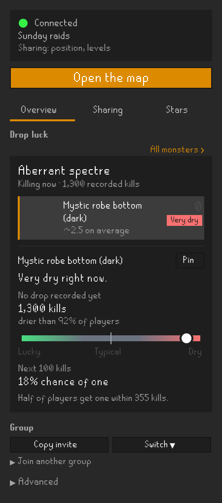 | 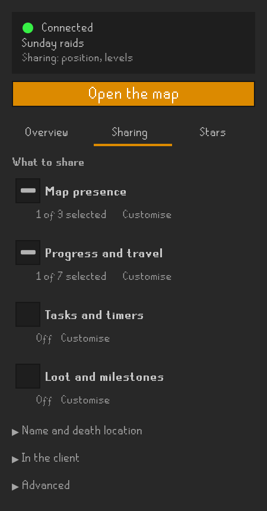 | 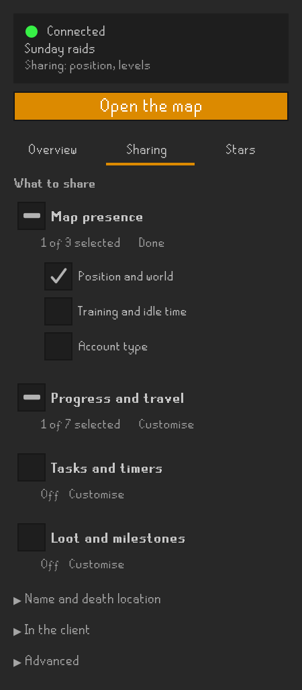 | 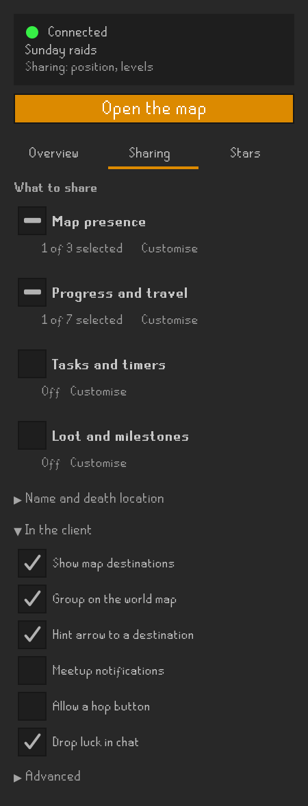 | 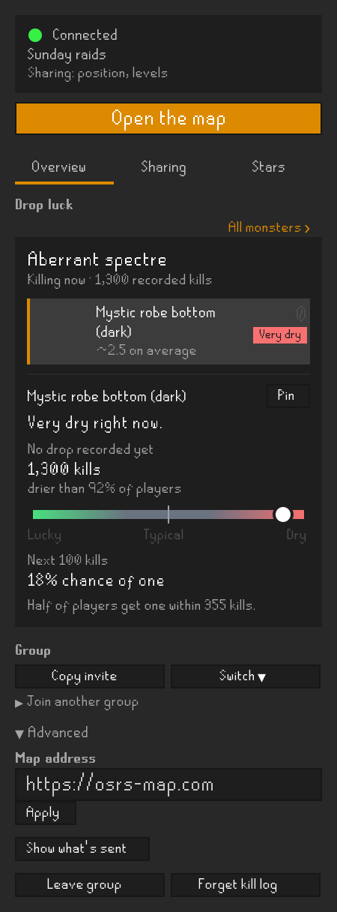 |

The pictures were painted again on 12 October 2026, after Drop luck and the world-map settings
landed; the first set still showed How dry, which made it look as though the plugin had not
changed when the website did.

**A group is a shortcut, not a saved permission.** Selecting it enables only the fields it lists
today, by writing their existing setting keys. A new field in a future version still starts off.
An empty group shows Off, a full group shows All N selected, and a partial group shows a native
dash with N of M selected. Pressing a partial group's checkbox selects its remaining fields;
pressing a full group's checkbox clears them. Customise only opens the individual choices.
The one press at Connect, below, is these shortcuts run once with every group ticked.
Switching tabs preserves both choices and open sections. Hidden Sharing does not reserve its
expanded height in Overview.

Map presence has position/world, activity and account type. Progress and travel has seven
choices, Tasks and timers seven, and Loot and milestones four. Character name and death location
remain separate opt-ins, with the alias in their own fold. Client actions remain separate too;
no sharing group enables destinations, notifications or hopping. Pet and collection additions
still depend on the existing notable-reward switch, explained inside Customise rather than
enabled implicitly. All defaults and native per-setting warning metadata are unchanged.

**Show what's sent stays available under Advanced.** It still uses the actual snapshot builder;
removing its daily button does not remove the way to check what is shared. The first Connect
disclosure still precedes every request to a new server. Choosing data never approves a server
and never repeats the sidebar's IP dialog. The default address remains `https://osrs-map.com`,
with no explanatory line beneath its field.

The photographs paint the real Java panel with RuneLite 1.13.1's own FlatLaf and font at 225px
wide, with PNGs at 2x. Native controls fit in all twelve inspected states: fresh, Overview,
Sharing closed, each of the four Customise sections, name/death, all selected, Advanced, and
busy Overview with and without the manual hop opt-in. These use synthetic local state, with no
game login or connection. Heights include the status and map button:

| State | Height |
| --- | --- |
| Fresh Overview | 221px |
| Paired Overview with Drop luck and group actions | 510px |
| Sharing closed | 430px |
| Map presence Customise | 513px |
| Progress or tasks Customise | 617px |
| Loot Customise | 575px |
| Name and death location open | 516px |
| In the client open | 586px |
| Overview with Advanced open | 608px |
| Busy Overview, destination/meetup/death | 688px |

Drop luck is what made Overview taller: How dry was three lines, and the card that replaced it
shows the monster being killed, its rated drops and the odds on the next hundred kills. Every
other state measures what it did.

The renderer and quiet logger are in `docs/review-evidence/sharing-sidebar-2026-10-11/`.
From the plugin root, reproduce in PowerShell with Java on PATH:

```powershell
.\gradlew.bat harnessJar '-PruneLiteVersion=1.13.1'
$taskEvidence = 'docs/review-evidence/sharing-sidebar-2026-10-11'
$taskClasspath = (Get-Content build/harness/classpath.txt -Raw).Trim()
New-Item -ItemType Directory -Force -Path build/sidebar-shots, build/sidebar-shot-classes | Out-Null
javac -proc:none --release 11 -cp $taskClasspath -d build/sidebar-shot-classes "$taskEvidence/SidebarShot.java"
$taskLogger = (Resolve-Path "$taskEvidence/logback.xml").Path
java '-Djava.awt.headless=true' "-Dlogback.configurationFile=$taskLogger" -cp "build/sidebar-shot-classes;$taskClasspath" com.pbolduc.mapcompanion.SidebarShot build/sidebar-shots
```

On Linux or macOS the same, with `:` between classpath entries (the generated file uses `;`):

```sh
./gradlew harnessJar -PruneLiteVersion=1.13.1
ev=docs/review-evidence/sharing-sidebar-2026-10-11
cp=$(tr ';' ':' < build/harness/classpath.txt | tr -d '\r\n')
mkdir -p build/sidebar-shots build/sidebar-shot-classes
javac -proc:none --release 11 -cp "$cp" -d build/sidebar-shot-classes $ev/SidebarShot.java
java -Djava.awt.headless=true -Dlogback.configurationFile=$PWD/$ev/logback.xml \
  -cp "build/sidebar-shot-classes:$cp" com.pbolduc.mapcompanion.SidebarShot build/sidebar-shots
```

The full Java 11 build passes 341 tests in 56 classes. The added interaction checks cover group
scope, partial selection, external settings changes, tab sizing/state retention, and the
separation between data preferences and connection consent. Existing warning and snapshot
privacy tests still pass. This verifies the native UI and its configuration behaviour; the
logged-in smoke test and Plugin Hub review remain the release checks in the submission guide.

## The Stars tab, 11 October 2026

A third view beside Overview and Sharing: the map's own star list, grouped by landing site with
the worlds underneath and favourites first, filtered with the website's meanings. Expansion and
the selected world belong to this sidebar; filters and favourite sites follow the reader's
paired browser while **Sync filters with website** is on. Mining level and skill total filter
the list here and are never sent for it. Only **Pin destination** and the opt-in **Hop to
world** act, and both only from a press.

**Where the first build was wrong.** It rendered shifted right by half a column with every line
cut off at the right-hand edge, the tier picker reading "…", and the world rows clipped to their
first two columns. BoxLayout lines children up by their alignment point, and the filter row and
site cards were centred among left-aligned labels. Every child of the tab's stacks is now
left-aligned and as wide as the column, the tier picker keeps the width its longest value
needs, and a world row lays its four columns out as components rather than as an HTML table.

Painted the same way as the views above, from the website's own projection of a fixed set of
calls (`src/test/resources/companion-stars.sample.json`). Heights include the status and map
button:

| State | Height |
| --- | --- |
| The list, collapsed | 574px |
| Rimmington mine open, W330 selected | 648px |
| W330 pinned, hopping on | 648px |
| More filters open, a favourite with no star | 786px |

`StarsShot.java` in `docs/review-evidence/stars-tab-2026-10-11/` builds on `SidebarShot`; compile
the two together, after `harnessJar`, with the classpath and logger from the block above:

```powershell
javac -proc:none --release 11 -cp $taskClasspath -d build/stars-shot-classes "$taskEvidence/SidebarShot.java" docs/review-evidence/stars-tab-2026-10-11/StarsShot.java
java '-Djava.awt.headless=true' "-Dlogback.configurationFile=$taskLogger" -cp "build/stars-shot-classes;$taskClasspath" com.pbolduc.mapcompanion.StarsShot build/stars-shots
```

## On the game's world map, 12 October 2026

Status: **built**. What the plugin draws on the world map is one picture, `MapPin`, in four uses:
a friend in their disc's colour with their initials, the same friend faded once they have been
quiet for thirty seconds, the destination in the map's amber, and the next meetup marked M.

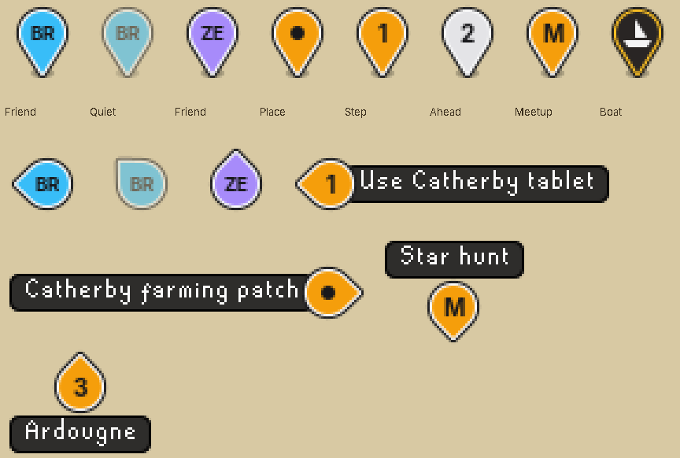

**A pin while its place is in view, a disc on the edge while it is not** (the bottom row). A
point that vanished when the map was panned away said nothing about which way to go, which is
the one thing a destination or a friend somewhere else is for. RuneLite's Party and clue plugins
make the same choice with the same API, so the edge reads the way a player already knows.

**Drawn, not loaded**, for the reason the destination's dot always was: a bundled PNG is one more
artifact for a reviewer. The colours are the website's palette, so a friend is one colour on the
map, in its panel and here. The pin's point fades with the disc; drawn solid under a faded disc it
read as a second, darker marker.

**Settings.** *Show my group on the world map* starts off and is the only thing that asks the map
for anybody's position. *Point the game's arrow at a destination* starts on, and only acts on a
destination the reader already chose to receive or pinned; it never replaces an arrow the game or
another plugin set. Both are in **In the client** above.

The picture is the real `MapPin` at three times its size on the world map's parchment colour,
from `docs/review-evidence/world-map-2026-10-12/PinShot.java`; compile it beside the plugin's own
classes (`build/classes/java/main`) and the harness classpath above. A running client is still the
check for where the pins sit among the game's own icons, and is in the submission guide's list.

## The one press at Connect

Status: **built**, on `claude/where-to-go`, step 9d of `docs/plan-where-to-go-for-a-task.md` in
`osrs-stars-map`, and not yet seen in a real client. Every setting still starts off; the press is
the opt-in.

After a first Connect to a map, a card under the connecting line, *Choose what to
share*, with one short row per choice:

- the four groups as bold checkboxes, all ticked; the loot row reads *Loot and milestones · kept
  two weeks*. A partial group shows the dash.
- *Character name*, ticked, and *Where you died*, not.
- *Drawn in this client*: *Show map destinations* and *Group on the world map*, ticked, and under
  them *Opens one connection while you're logged in.*
- *▸ What each one sends*, a fold holding each row's name over what it sends: the groups' fields in
  the Sharing tab's words, *Position and world · Training and idle time · Account type*, naming only
  what is ticked so it always says what the press will send; *Your group keeps the last two
  weeks.* under the loot fields; and the receive stream in full.
- *Sent to osrs-map.com while you're logged in; your group sees it.*, then **Share what's ticked**
  across the card, and *Customise* and *Not now* as links. Customise shows a checkbox per field
  under each row, with the two-weeks line under *Notable drops and levels*; it reads *Fewer
  details* while open.

Ticking anything in the card, Customise and Not now write nothing. The press writes the ticked
settings that are off, the way a group's checkbox does, then folds the card; the status card's
sharing line is the answer. The card follows only a Connect that showed the notice and only while
every choice it offers is still off, and it is never remembered, so an update or a restart never
brings it back. Leaving the group takes it away.

At 225px the card is 443px tall with the fold closed, so the press is in reach without scrolling;
953px with *What each one sends* open and 1,015px with Customise. `WhereToGoShot` paints the three
as `connect`, `connect-fold-open` and `connect-customise`, pointed at a port nothing listens on.

## The way there, step by step

Status: **built**, on `claude/where-to-go`, and not yet seen in a real client. It is steps 5a to 5c
of `docs/plan-where-to-go-for-a-task.md` in `osrs-stars-map`.

- **Under the destination's name**, when the map sent a route: the way being followed and its
  length in run tiles, *Lumbridge Home Teleport · 52 tiles*, then its steps in the card's own words,
  numbered as the website numbers them, each with the detail and notes the card prints under it.
  The numbers stand in a column of their own, 14px and right-aligned, as the website's journey row
  puts them, and a wrapped title and the lines under it start under the title's first letter.
- **A teleport step's picture** sits between its number and its words: the item's sprite or the
  spell's icon, at 16px, as the card's sprite for that row. The map sends the game's id for it and
  the client's own cache draws it; a walk, a ride, or a teleport the map has no id for stays words
  alone, and keeps the picture's place once any step of the way has one, so the words start at one x.
- **Beside the destination's name**, when a Route pressed here made it, is the picture the row that
  asked drew: the clue's scroll, a search row's sprite or world-map icon, a friend's disc as the
  world map draws them, at 16px. It stays with that press's answer, so a destination the map sends
  has none, and it is never sent: the request is built from the id, the clue and the tile alone.
- **The current step** has its number in bold amber, the colour its pin has on the world map, and
  its title bold and white. A step behind it goes grey and keeps only its title, its picture faded as
  its pin is, so what is done stops pushing the step being walked down the card. ▸ and ▾ open folds
  and mark nothing else. The step moves on when you stand within four tiles of where it ends, on its
  floor. Inside a raid's rooms nothing moves, because the tile there is not a place.
- **On arrival** the card changes shape rather than greying a route still drawn: the way, its steps
  and the other ways go, and one amber line, *Arrived*, takes the way line's place. Reroute and
  Dismiss stay, Reroute because an arrival read wrongly still needs its way out. A run's leg goes
  whole, since the stop it led to already says *You're here*.
- **The other ways** fold behind one line, *▸ 2 other ways*, as the card's closed row folds them.
  Pressing one shows its steps instead; the best one says so. Each starts with the picture of the
  first of its steps that has one, the ring or the tablet, as the website's route chip leads with
  its teleport; a way not open yet is grey, its picture faded, and still shows its steps.
- **Reroute** sits beside **Dismiss**, and plans again from where you stand. While the answer is
  on its way the card says *Planning from where you stand…*, and a refusal is one plain sentence
  under the steps. A route ranked from no position says so above the steps. A destination with no
  way yet, a star pinned on Stars or a place the map sent bare, has **Route** in Reroute's cell
  instead: it asks by the destination's own tile, as a star's Route does, so the card that shows a
  place can always lead there.
- **On the world map** each step's end has a pin with the step's number. The current one is amber
  and holds the map's edge, the ones behind it fade, and the last step leaves the destination's
  own pin uncovered. The game's arrow points at the current step's end once it is loaded.
  While the current step's pin holds the edge, the destination's own pin lets go of it: two amber
  discs side by side there, one numbered, said nothing about which way to go. It is drawn as
  before while its place is in view, and holds the edge again on the last step.
- **Follow**, beside Reroute, shows the step you're on in the box over the game and, while the
  Shortest Path plugin is running, has it draw each walking step as you reach it; it reads **Pause**
  while following, the word a run's card and the *Follow and pause key* use for the same act, and
  its tip says the path Shortest Path drew is cleared. It is offered wherever following shows
  either, so a route somebody sends reaches the box without Shortest Path, and one pressed here can
  take the box down. A line under the steps says when Shortest Path is drawing one, *Shortest Path
  is drawing the walk for step 2.*, so its line on the ground is never taken for this plugin's.
  Reroute follows too, being your own press; a destination that merely arrives never does.

### Search, at the top of Overview

Step 6 of the same plan. A box at the top of Overview while connected, as the drop-luck list's own
box is drawn, and under it up to eight places in the website's order, each with the website's
grey line and the effort it measured, *Bank · 2nd floor · ~40 tiles*. An item's sources carry the
website's *Sold at* or *Dropped by* heading, and a name a partial query could mean is a row of its
own, *Item · dropped by 3*. A misspelling is one button, *Did you mean abyssal whip?*, which searches
for it. A pick plans the way and fills the destination's card, so the list folds once that answer
lands; typing or Enter opens it again. A refusal leaves the rows up, so the next one is a press
away. While any card's route plans, or inside the map's wait between two, the rows take no pick and
grey their names, as every Route button greys: a pick then would only be refused, and would replace
the other card's *Planning…*. One line under the box, above the rows, says *Searching…*, *Planning
the way there…* or the map's refusal with the row's name, *Al Kharid bank: …*.

### Route beside a clue, a death, a star and a meetup

Step 8. Each card under *Now* that names a place gains the way there, planned from where you stand:
**Route back** beside the death's *Show on map*, **Route** on the meetup's card, and a clue card,
*Hard clue* over *Coordinate · dig at 2896, 3119*, whose Route appears when the step names a tile.
In Stars, Route sits beside *Pin destination* for a precise site; an approximate one has **Open on
map** there instead. While the map answers the button reads *Planning…*, and a refusal is one line
under it, in the map's own words when it gives them, as it does for a clue step it cannot place.
The answer fills the destination's card, as a pick from Search does, and a star's is drawn under the
star on Stars too (see *Stars* under 29 October). The line a press writes under the destination's
name is written once, so it holds nothing that ages: a meetup's day and clock, *Today 7:52 PM*, with
no countdown; a search row's words without the distance it measured from where the search was
typed, since the way line gives the route's own; and for a star only its world, since a tier and a
time left go stale by the minute and Stars keeps the star's line live. While it is there, the death's,
the clue's and the meetup's button reads **Reroute**, as a friend's does, so the card above is not
offered again as new; Dismiss gives back their own word. Route back's answer has no line under its
name: the death card keeps the age counting, and an age written at the press sat above it, older.

Under the death, the card says how long its gravestone has left, *Gravestone · 8m left*, over a
thin orange bar that is full at the first reading and drains, as RuneLite's Time Tracking draws one.
The where-to-go plan in `osrs-stars-map` (§ 5.4) left a timer out because a figure would be a
guess: how long a stone stands varies. This one is not a figure worked out here but the game's own
timer, `GRAVESTONE_DURATION`, which counts game ticks as the game's HUD script reads it. It shows
only while `GRAVESTONE_VISIBLE` says a stone stands, the session has settled, the timer reads no
more than the fifteen minutes the game itself prints, and the stone appeared after the death the
card is about; otherwise the card says only how long ago, as before. Nothing about it is sent.

### Friends and meetups under Group

Step 9, from `plan-companion-social.md`. Under the Group heading, one card per other member: their
disc in their map colour with presence as a dot in its corner, never as words; *near Lumbridge
Castle · Near you*; their newest news, *Woodcutting 80 · 5m ago*; then **Route** and **Show on map**
for a friend whose position the map draws. A friend sharing no position is a name and a dot. Route
reads *Finding…* while their position is asked for, *Planning…*, then *Reroute*. A friend inside an
instance has no tile the map can plan to, so Route asks nothing and the row says *Cara is inside an
instance. Route works once they're out.* With the group
layer on, Show on map reads *On the map* and is not pressable.

Then *Meetups*: each with its title, *Today 7:42 PM · in 1h 20m* — past twelve hours the day and
the clock alone, *Wednesday 8:59 PM*, as the line under *Now* counts — *near Lumbridge Castle · W302*,
who is coming as discs (solid for coming or here, a ring for maybe, faint for can't) with *1 here ·
1 coming · 1 maybe*, **Route**, and the four answers in a two-by-two grid with this member's own
filled, an answer pressed included while it is on its way: the pick ignores a press then rather than
greying, since a greyed button loses its fill. *On my way* is one of the four, and Route beside them tells nobody. A map that sends no `events` leaves the one meetup under *Now*,
as before. **Meet here…** opens a form under them: a title, a day of the coming week, an hour and a
minute in fives, defaulting to half an hour from now, and **Make meetup**, which copies the link.
Like the single meetup under *Now*, the week's meetups are taken only while *Show map destinations*
is on; while it is off, one grey line under the heading says why the section is empty and where the
setting is.

A friend's or a meetup's way fills Home's destination card, a tab away from the button, so when it
lands while Group is still the tab showing, the sidebar turns to Home once, with the card in view.
A refusal stays under the button that asked, a tab the player has moved to since is left as it is,
and a star's way stays on Stars, under the star.

`docs/review-evidence/where-to-go-2026-10-29/WhereToGoShot.java` paints the real panel in each of
these states (steps 5a, 6, 8 and 9) at 225px with made-up names; how to run it is in its docblock.
No picture is committed yet; step 12 takes the README's.

## Home, Group and Stars, with Settings behind a gear, 29 October 2026

Status: **built**, on `claude/sidebar-polish`, one commit per item. The review and the owner's
picks are `docs/plan-last-polish-pass.md` and its `plugin-findings.md` in `osrs-stars-map`; this
section says what each item changed here, in the order they landed. The sections above are kept as
they were written, so where they say *Overview* and *the Sharing tab*, read Home and Settings.

`docs/review-evidence/sidebar-polish-2026-10-29/SidebarPolishShot.java` paints the real panel in
every state below at 225px, against this branch or the commit before it; how to run it is in its
docblock.

### The structure

The tabs are **Home · Group · Stars**. Home is the search, *Now* and Drop luck. Group is the
friends, the meetups and the group's own buttons, and its tab counts the friends, *Group · 3*.
**Settings** is a page behind a gear on the status card, with an arrow back at its top: *What you
share*, then the **Advanced** fold with the map address, *Show what's sent*, *Leave group* and
*Forget kill log*. Advanced no longer hangs under every tab. Before a group is joined the tabs are
not drawn and Home is the page, because Group and Stars both ask the map as a member. The gear and
the arrow are drawn, not loaded, as the destination's dot is. On the busy state Home is 819px where
Overview was 1,243.

### Search

No type filter: eight rows already come sorted by kind, and the website's six chips need two rows
at 205px. Each row has the game's own icon beside it instead — the world map's for a bank, a ride, a
patch, a mine and, under *Sold at*, the general store's sign; the combat tab's for a monster; the
minimap's yellow dot, drawn, for a character; and an item's own sprite, by the `itemId` the map now
sends where its tables name one, or else by the item's exact name in the client's own price table.
The box is a plain field, so it can say *Search places, people, items* while empty, and item rows
have their own *Items* heading: they were drawn under the last source's, so *Bank filler* read as
one more counter under *Sold at*. Their line no longer starts *Item ·*, and each count says what it
counts, *Dropped by 3 monsters · sold in 1 shop*: a bare *Dropped by 3* sat under a heading listing
two monsters. A pick from them names the item on the destination's card, *For Abyssal whip*, since
the card takes the name of the monster or shop the route goes to. One letter in the box says *Type
one more letter.*, where it showed nothing.

### Before a group is joined

The status card says *Not connected* beside its dot, and nothing under it: the map's address was the
second line and *Character sharing paused* the third, about a connection that did not exist yet.
Then Open the map, and the code field with no heading over it, its placeholder *Paste your
connection code* and its tooltip saying where the code comes from; with a kill log, Drop luck
follows. A fresh install is 130px where it was 221.

Since `docs/plan-plugin-first.md` in `osrs-stars-map`, the one filled button says **Connect** here,
because it makes a group, and *Open the map* once there is one. A small *Have an invite?* heading
goes over the field, its placeholder *Paste an invite or code*, and **Paste** and **Join** under it:
the field is the other way in now, and the heading says which of the two a friend's message is for.

With an invite or a RuneLite code in the field, **Connect** joins it as Join would. Pasting a friend's
message and pressing the loud button is what an invited friend does first, and it made them a group
of their own and emptied the field the invite was in. The button still says *Connect*, as the
plugin-first plan has it, and its tooltip says *Join the group this invite is for*. A code alone
does not count, because its alphabet spells ordinary words; Join takes that. After Paste the field
shows the start of the message rather than the tail of the link's token.

While Connect or Join waits on the map, the status card says *Connecting…* beside an amber dot and
the line under the field is quiet; it said *Not connected* over a button reading *Connecting…*, and
the line said it again. A Connect that made no group says why on the card until the next press:
under the field it read as being about the invite. Join's refusals stay under the field, because
they are. Otherwise the dot is grey before a group, where the connection's own state coloured the
same *Not connected* amber at the login screen and grey in game.

### The step after Connect

It said *Waiting for the map* twice, once beside the dot and once under the field, and the tabs and
Home hung under the card. Now the status card says it once, nothing is drawn under the card while it
is up, and its intro is one line: *Ticked is what the map uses. Change any of it later in
Settings.* The one press, every field named, *What each one sends* and *kept two weeks* are as they
were. 738px to 544.

### Which map a button opens

*Show on map* opened the website on the death card and drew on the game's world map on a friend's.
Every button that opens the browser now says **Open website** — the death's, and an approximate
star site's, which said *Open on map* — and a friend's says **World map** (*Show on world map* does
not fit beside Route), *Hide on map* once pressed, and *On world map* while the whole group layer is
on.

Slayer's button beside Route says **Pin**. It said *World map*, but it makes the place this client's
destination, as Stars' *Pin destination* does: Home's card, the arrow and the world map's pin. A
friend's *World map* draws only that friend's dot, so the one word named two acts.

### The group's buttons

They were three loose rows under the meetups: *Meet here…*, *Copy invite*, and *▸ Join another
group*. *Meet here…* is now a link on the *Meetups* heading, which is drawn with or without a meetup
under it; *Copy invite* sits beside *Switch ▾*, which is always there; and *Join another group…* is
the menu's last row, under a rule, reading *Hide the code field* while the field is open. In a group
of one, which is how Connect starts every group, *Copy invite* sits instead in the card that says
*Just you so far*, under the sentence about it, and goes back beside *Switch ▾* once a friend is in.

Each of these presses is answered under itself. One line above the tabs said everything, so *Invite
copied* and *Renamed to Sunday raids.* landed against the tab strip, out of sight once the Group tab
had scrolled, and pushed the tabs down a line. Copy invite and the menu's *Rename group…* now answer
on a line under *Copy invite · Switch ▾*, and Copy invite reads *Copied* for two seconds as well,
since in a group of one it sits in the card at the top of the tab. The status card's own *Rename
group…* answers in the card. *Join another group…* opens the field under the same row, *Hide the
code field* folds it there, and a refused invite is said under its Paste and Join. Before a group,
after a new map address and while the map refuses the group, the field stays under the orange button,
where nothing else offers a way in. In Settings, Apply's refusal is said under Apply, where it waited
behind Back before, and an address typed without its scheme gets https://, or http:// on this
machine, in the field rather than a refusal. Connect's own answers were already on the status card.

### A meetup's Route

A meetup was three rows of buttons: Route, then the four answers two by two. Route now sits beside
the title, and the four answers keep their grid. A meetup card is 146px where it was 186.

A friend's **Route** sits beside their name the same way, reading *Finding…*, *Planning…* and
*Reroute* there, so the words are next to the name they are about. **World map** keeps the row
under the card, and with the group layer on it still reads *On world map* and is not pressable.

### The status card

Three lines became two. While the map is being fed the dot's green is *Connected*, said in words in
its tooltip with the last post and the stream, so the first line is the group's name and the second
what is shared, *Sharing position, levels*, with the gear at the end of the first. While it is not,
the first line says what is happening — *Connecting…*, *Logged out*, a refusal — and the second is
the group's name. The connect step is 532px.

*Connecting…* lasts only until a post has failed. A map that is down, or that this network cannot
reach, then says *Can't reach the map · retrying*, where it said *Connecting…* for good and looked
exactly like a connection about to work; the dot stays amber until a post lands. No first line
prints an HTTP status: *The map answered 503* became *Map having trouble · retrying*, with the number
kept in the dot's tooltip for a bug report, and a full relay is *Map is full · retrying* on one line
rather than three. Each of these fits the 141px beside the dot, where *The map is having trouble ·
retrying* would leave *retrying* on a line of its own. A plugin turned on while RuneLite sits at
the login screen says *Logged out*, as a client start does, rather than *Not paired* beside the
group's name.

A refusal the map holds to is a few words in the refusal pink beside the red dot — *Needs an
invite*, *Removed from this group*, *This group was closed*, *Group gone from the map*, *Group is
full*, *Group code not accepted*, *Plugin out of date* — with the map's whole sentence in the dot's
tooltip. It was the sentence, a white column of three lines beside a dot and a gear centred on it,
and it stopped there: the field it named opened only from Switch ▾. Where an invite or a new code
answers the refusal, *Have an invite?* and the field now show under the orange button, the field
Join another group… opens, with the next step under Paste and Join: *Ask someone in Sunday raids
for an invite and paste it here.*, or, for a group that has let the player go, *Paste another
group's invite here, or use Leave group in Settings → Advanced to start over.* The relay keeps which
refusal it was until a post lands or the code changes, not for the five minutes its sentence keeps
for one retry, so the field and the words do not go, and the group's name does not come back
green, between two refusals. The dot, the first line and the gear keep to the first line. Every
other refusal, a redirect among them, is its sentence in the same pink without the field. The rest
of the page stays as it was: drawing the page a player without a group sees, with Connect starting
a new one, would reverse Connect's rule that it reconnects a saved code, and waits for the owner.

### Stars

*Sync filters with website* and *Mining 72 · Skill total 1620* sat above the list as daily
controls, though both are set once. They are now the first rows of ⋯ More filters, and the levels
line says what it hides: *For Mining 72: up to T7 · worlds up to 1620 total*. *Selected world*
stays at the top, once the player picks one: nothing is picked for them, so the tab opens on the
list, a pick goes when its star leaves the feed rather than moving to another, and a pick the
filters hide is not offered until they show it again.

Once a star's Route is answered, its way is drawn under the star, in a card between the star's
live line and its buttons: the steps Home's destination card draws, read from the same route, with
Home's own Follow and Reroute, offered and pressable exactly when Home's are, and **Unpin** as a
button where Home has Dismiss. Star hunters hop from this tab, and steps a tab away cost them their
place in the list; Home's card still shows the same route, and nothing switches tabs. A star pinned
with no way yet keeps **Route** beside Unpin, so the way there is one press rather than Unpin, then
Route.

A star's tier is drawn in the map's own colour for it, the dark ramp of `lib/tier-color.ts`, so T7
is one pink here and in the map's list; its time left keeps the line's ink until it is under twenty
minutes, then turns amber, and red under five, the website's tones by the minutes printed. A
depleted star's *Depleted* is grey. The picked world's row is darker than it was so that every
tier's colour still reads on it, and the soon-ending red is deeper than the pink a refusal and the
Wilderness are written in.

*Pin destination* was bold on the brown Group gives the meetup answer already chosen, beside a plain
Route; it is now as plain as Route, so *Open the map* stays the one loud button and brown keeps its
one meaning. A filter chip that is on carries the orange outline of Drop luck's chosen sort, where
only a fill a few shades lighter told P2P on from F2P off.

### Drop luck's heading

The section's heading took a row of its own over a row that was empty on the left: the card's
eyebrow says *Last monster killed* or *Your pinned drop*, and nothing while the card is the monster
being killed or one opened from the list. In that empty place the card now says *Drop luck* itself,
beside *All monsters ›*, and the sidebar drops its own heading. With words in the eyebrow, under the
*Now killing* bar, or while counting is paused, the heading stays where it was. The card's wording is
unchanged.

## The RuneLite pass, 1 November 2026

A review of the sidebar as built, after the plugin stopped needing the website first, asked what
RuneLite offers that the plugin did not use and what the pictures showed was off. Each change below
was checked first against the decisions already written down here and in `osrs-stars-map`; three
proposals were dropped for that reason, and are named at the end.

### Tasks under Now

The last polish pass placed the task cards on Home "under a *Tasks* heading, below Now, one card
each", and the owner took that pick. They were built above Now, so an idle farm run's picker sat
between the search and the route being walked. Home is now the search, *Now*, *Tasks* and Drop luck.
The *Tasks* heading hides with the last visible card, as *Now*'s does.

A Slayer task with nothing left to kill folds to its row, *Gargoyles · Complete*, and the step that
changes it, *Get your next task from a Slayer master.*, until the next task is read: a place and its
Route are no use to it. The closed card ends on *OSRS Wiki ↗*, its source, and *CC BY-NC-SA 3.0 ↗*
is in the fold after the options, where the website's Slayer block keeps its licence.

### Actions are buttons

*Start run*, a run's *Pause route · Reroute · End run* and Slayer's *Route · World map* were drawn as
links, which this panel keeps for a fold's own opener; every other action, the destination card's
*Follow · Reroute · Dismiss* among them, is a small button. They are small buttons now. A run's
three share one row the card's width, rebuilt by the destination card's own `syncRow`, so a button
that comes back takes its old place. A third of the card is too narrow for *Pause route*, so the
button says *Pause* and its tip says the rest. *Customise* and *Not now* in the step after Connect,
and *Meet here…*, stay links: those were chosen as links and kept by the owner.

### This leg

A run's card lists its stops and then the steps of the leg being walked, and the leg's *Walk*,
*Board*, *Sail* and *Dock* read as more stops at the bottom of the list. A hairline and a *This leg*
heading now sit over them, shown with the steps. The steps keep words where the map sends no picture:
a walk, a ride, or a teleport the map has no id for stays words alone, and the client names no
constant for a boat's icons, so none was added.

The leg came after the last stop, so the step being walked sank as stops were finished, two stops
below the one it served. It now sits directly under the stop it leads to, between its hairline and a
second one that keeps its last numbered step from running on into the next stop's number. A stop
behind the player folds to one line that keeps its *Done* or *Visited*.

### Rename beside a new group's name

A group made by Connect is *Our group* until somebody names it, and renaming lives in the menu under
*Switch ▾*, which nothing on the status card hints at. For whoever runs the group, the status card
now shows *Rename group…* under the name while it is still *Our group*; it opens the menu's own
dialog, and goes once the group has a name. A member who does not run the group never sees it. It is
a link coloured as *Meet here…* is, and *Switch ▾* and its menu are unchanged. The starting name is
the map's `DEFAULT_RUNELITE_GROUP_NAME`; if the two ever differ, the link stops showing and the menu
still renames.

### Clues by their words

The clue card offered Route only for a coordinate or a beginner map, and told a step in words to
open the website. The map's route door has placed a clue from its words since 29 October, and the
where-to-go plan listed the plugin's half as left out. A worded step now shows its words and Route,
and the press sends the clue as the snapshot carries it; the card takes the name of the place the
map reads from the words, and an emote's way goes by its STASH unit first. A step with a tile still
goes as that tile, so the words leave only when they are what the map needs.

A map above beginner has neither words nor a tile, so its card said *Read the scroll to see its step*
over a scroll the player had just read, with no Route. Each such map is a scroll of its own, which
RuneLite's clue plugin and the map's table both know by item id, so Route now sends the clue as a
worded step is sent, with its tier and scroll alone, and the map names the picture's place; the
card says *Map · Route finds where it shows*. Nothing new goes over the wire. A beginner's pictures
share one scroll, so they still go as the tile of the picture opened.

### The farm run's picker steps aside

The farm run card kept its kind of run and *Start run* above a run being walked, and there is one run
at a time, so one press replaced it. The Port tasks card already held the rule "a run already held is
the order: no second Start beside it". The farm card follows it now: the picker hides while a run is
shown, planned or ended, and comes back when the card has no run. The rule holds across the two cards
too, since the map keeps one run a member and either card's Start replaces it: while one card's run
is walked, planned or ended, the other offers no Start, and one muted line stands where it was,
*Start a farm run after the port run ends.* or *Start run after the farm run ends.* A finished run
holds nothing back.

### Outside the sidebar

*Route here* on a right-click of the game's world map, the step being walked in a small box over
the game, a key each for Reroute and Follow, and a farm run's missing teleports outlined in the
bank. Each is a setting under *In the client*. Only Route here sends anything, and it sends what
Route sends; `docs/network.md` and the submission guide say so. Each is information or a press of
the player's own: the menu entry is RuneLite's and acts in nothing in the game, and a key presses
the sidebar's own button, so the rule that nothing acts in the game holds.

### Proposed and not changed

- *Open website* on the death card, beside *Open the map*, is not a slip. The polish pass chose
  *Open website* for every button that opens the browser and *World map* for the game's map, and
  *Open the map* is a different request, the one that makes the browser the player.
- *Rename group…* stays in *Switch ▾*, where the plugin-first plan put it and the README names it;
  a *Groups ▾* label was turned down before. The link beside a new group's name, above, is what
  changed instead.
- No star notifications. Stars are fetched only while the Stars tab is open, and an alert would
  keep the map asking Star Miners at hours nobody is watching, against the one condition they set.
  The owner has declined star alerts once already, and on 1 November declined the version that adds
  no request, an alert from the list the open Stars tab already holds.
