# The sidebar says its status first and puts one action in front

Status: **built**, on the branch of the same name. This is item 11 of a review of every surface
the map and this plugin draw; the whole review, its method and its other ten items are
`docs/plan-compact-pass.md` in `osrs-stars-map`, on the branch of the same name. The proposal is
kept below as it was written, under *The proposal*; what changed on the way comes first.

## As built

The real `MapCompanionPanel`, both sides of the change, wired through the harness's own
collaborators and painted with RuneLite 1.12.39's `RuneLiteLAF` into the 225px column — not a
transcription this time. The paired state is the proposal's: a destination with the hop setting
on, a meetup, a death seven minutes ago, 1,300 kills dry on a 1/512 drop, name and death spot
switched off, two remembered groups.

| | Before | After |
| --- | --- | --- |
| Paired, busy | 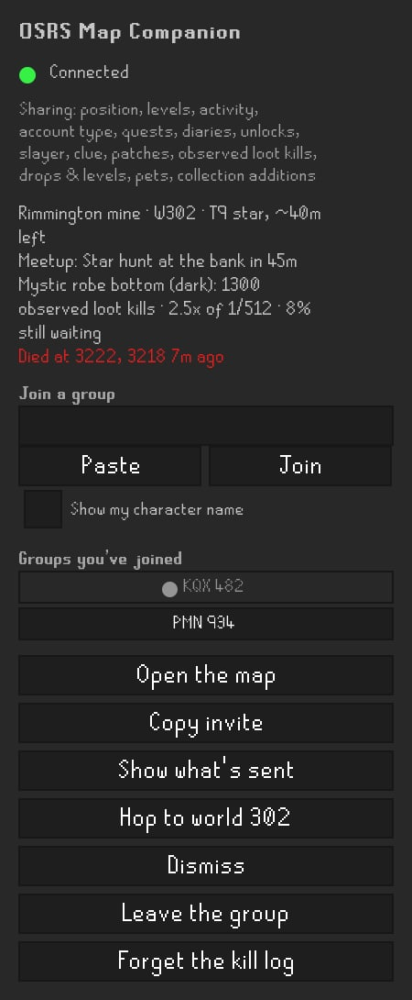 | 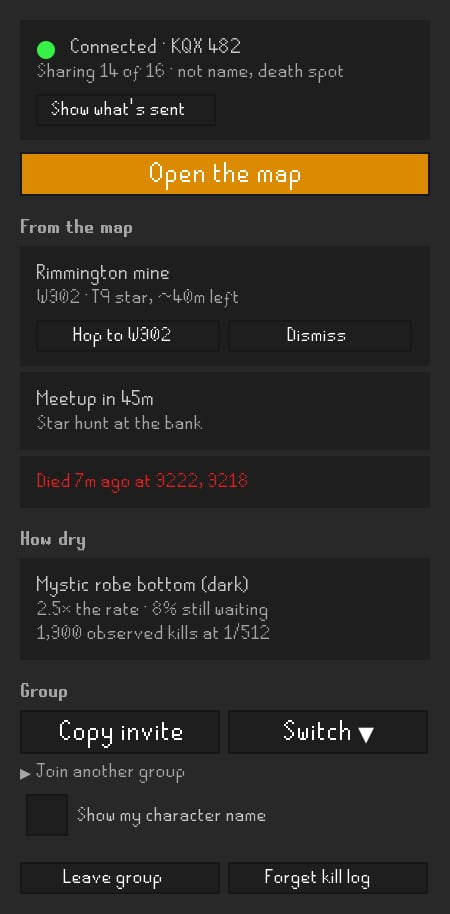 |
| Paired, nothing from the map | 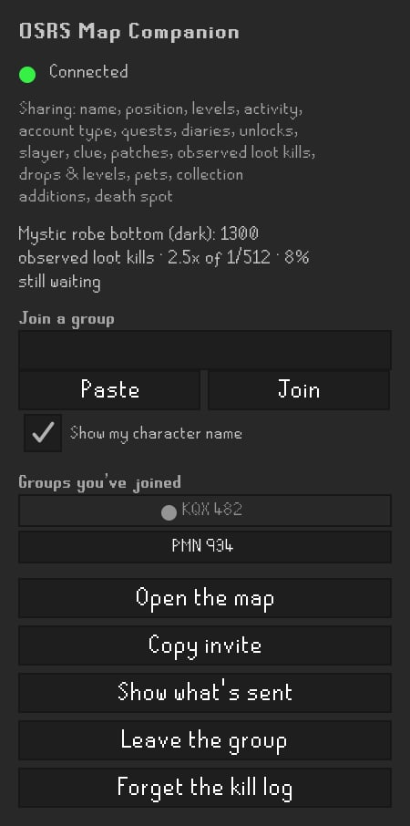 | 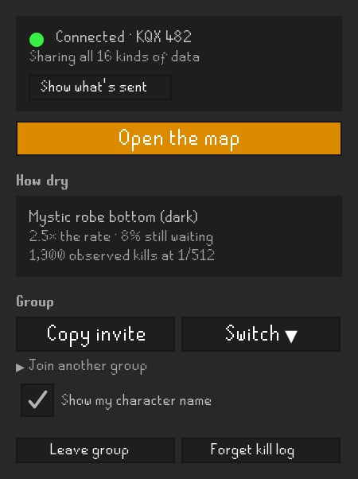 |
| No group yet, with a kill log | 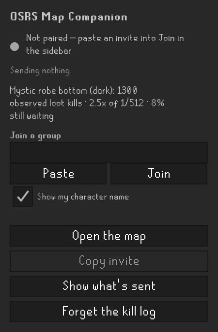 | 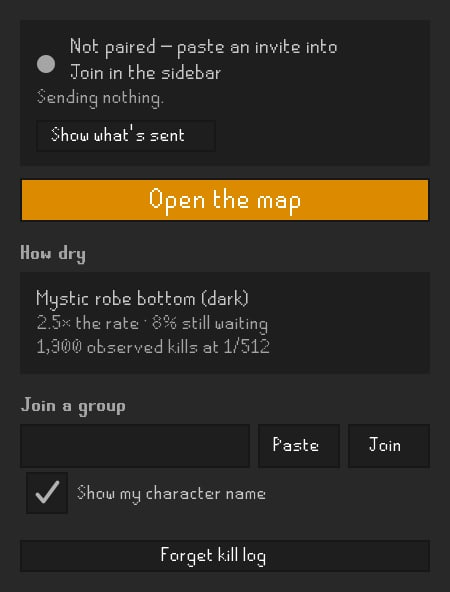 |
| A fresh install, nothing at all | 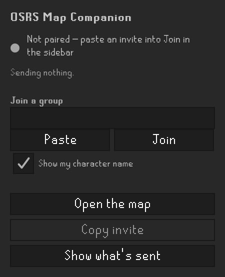 | 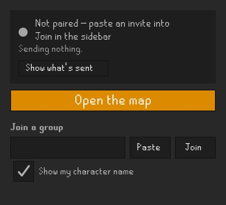 |

| State | Before | After |
| --- | --- | --- |
| Paired, busy, hop on | 545px | 457px |
| Paired, busy, hop off (the default) | 519px | 457px |
| Paired, nothing from the map | 453px | 301px |
| No group yet, with a kill log | 342px | 296px |
| A fresh install, nothing at all | 277px | 204px |

The transcription the proposal was drawn from held up: its "before" measured 544px for the busy
state, and the real panel measures 545. Its fresh install had a kill log in it, which is the
second-to-last row here; the last is what somebody who has only just installed it sees. Hop and
Dismiss sharing a row inside the destination's card is why the after costs the same with the hop
setting on or off; before, Hop was one more full-width button at the foot.

The renderer is `docs/review-evidence/compact-pass-2026-09-25/plugin/RealPanelShot.java` in
`osrs-stars-map`, beside the transcription it replaces, with how to run it against either side of
the change.

## Where the plan was wrong

- **How dry is three lines, not two.** The mock's *Draconic visage · 2.5× the rate* fitted; the
  first real item tried, *Mystic robe bottom (dark) · 2.5× the rate*, broke before "rate" at the
  195px the card leaves for text. So the item has a line to itself, then *2.5× the rate · 8% still
  waiting* — the multiple still never without the share — then *1,300 observed kills at 1/512*.
  `LootLog.driest()` returns the numbers as a value for this, and the one-line `driestLine()` it
  replaces is gone rather than kept with no caller. The busy state is 457px rather than the mock's
  441 and the unpaired one 296 rather than 283, and about 12px of each is that third line. Both
  sides of the table carry the same item, so it compares like with like.
- **Two words each, everywhere they are named.** *Leave group* and *Forget kill log* are short so
  they sit side by side, and the confirm dialog's title, the README, the Hub submission notes and
  `MemberSecretTest`'s assertion on the README now name them as they are printed. A button a
  document calls something else is a button a reader cannot find.
- **The remembered groups are a menu even before a group.** With groups remembered and none
  joined, the button reads *Your groups ▾* rather than *Switch ▾*, because there is nothing to
  switch from yet. The README said switching back was one press; it is one pick from a menu now,
  and says so.
- **The sharing line says "the line", not "the sentence".** The README and the Hub notes both
  described a sentence listing every kind; they now describe the count, what is switched off, and
  the full list on hover.

## The proposal

### The complaint

`MapCompanionPanel`'s own docblock calls **Open the map** "the one button that matters", and
the panel draws it after everything else: below the status lines, the join field, the list of
remembered groups, and then as the first of up to seven identical full-width buttons
(`syncButtons`, `MapCompanionPanel.java:608`). The status is a sentence beside a dot; what is
being sent is a sixteen-item sentence in 11px grey; a destination, a meetup, a dry streak and a
death are four loose lines, while the two buttons that act on the destination — **Hop to world
302** and **Dismiss** — are five rows further down among the ones that erase things.

### What it said

| | Before | After |
| --- | --- | --- |
| Paired, with a destination, a meetup, a death and a dry streak | 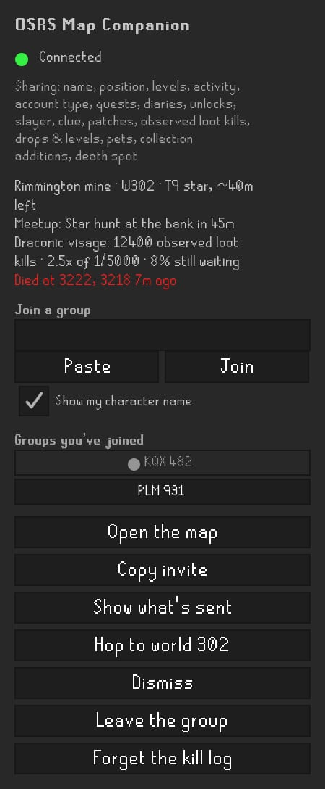 | 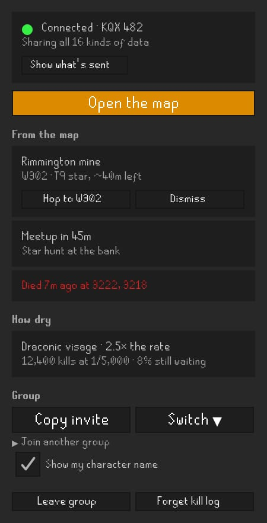 |
| A fresh install, no group | 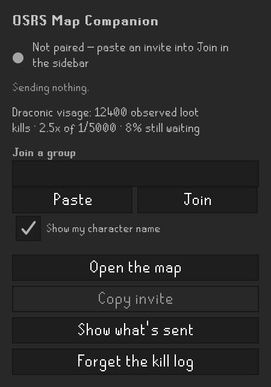 | 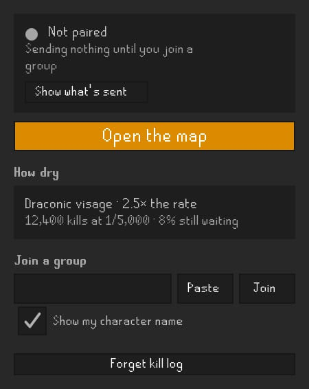 |

- **A status card first.** The dot, *Connected · KQX 482*, and *Sharing all 16 kinds of data*
  with **Show what's sent** beside it. The sixteen names move to that line's tooltip and to the
  window the button opens, which prints the snapshot itself; when something is switched off the
  line names what — *Sharing 14 of 16 · not name, death spot* — which says more than the full
  list did, because the full list is the default.
- **Open the map** as the one filled button, in `ColorScheme.BRAND_ORANGE`.
- **What the map asked for**, as cards, each holding its own action: the destination with **Hop
  to W302** and **Dismiss**, the meetup, the death.
- **How dry** in two lines with separators — *Draconic visage · 2.5× the rate* over *12,400
  kills at 1/5,000 · 8% still waiting* — rather than one line with `12400` and `1/5000`.
- **Group**: **Copy invite** and **Switch ▾**, the remembered codes as a menu instead of a
  column of buttons. Once paired, the join field folds behind *Join another group*, since
  `buildJoinBlock`'s docblock already says it is used twice.
- **Leave group** and **Forget kill log** side by side at the foot, quiet, because both erase
  something and neither is a thing a player does every session.

The panel title is dropped in the mock, because RuneLite's sidebar tab already names the
plugin; keeping it costs one row. Measured in the 225px column: 544px becomes 441 paired, and
321 becomes 283 on a fresh install.

### How the pictures were made

A Swing sidebar has no DOM to rewrite, so the "before" is `MapCompanionPanel`'s constructor
transcribed component for component — the same BoxLayout, the 8px gaps, the font sizes, the
colours, the 195px wrapped-label width, the button grid — beside the proposal, both painted with
RuneLite 1.12.39's own `RuneLiteLAF` and RuneScape fonts under `xvfb-run`. The renderer is
`docs/review-evidence/compact-pass-2026-09-25/plugin/PanelShot.java` in `osrs-stars-map`. The
state it fills in is written by hand, so the "before" is a transcription rather than a
photograph of a running client: worth one look in a real client before anything is built.

### Not in this proposal

- **Group names.** The remembered list shows codes (`● KQX 482`, `PLM 931`) because codes are
  all this installation stores; the map knows each group's name. Sending the name down with the
  snapshot reply would let the menu say *Sunday raids*. That is a relay field, not layout.
  *Built after, and described in* **Group names, built after** *below.*
- **The network behaviour.** Nothing here changes what is sent, when, or to whom; the README's
  *Network disclosure* stays exactly as written.

## Group names, built after

The menu under **Switch** says each group's name beside its code now:

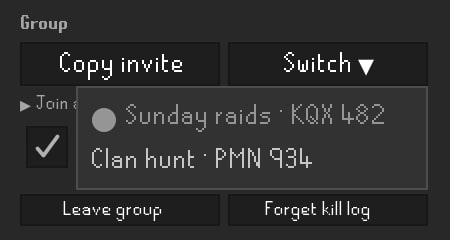

- **The map sends it.** `groupName` rides on the reply to every accepted post, beside
  `memberSecret`, and only on an accepted one — a stranger and a removed member are refused before
  it is read, and a legacy group has no name to send. It is repeated rather than sent once so a
  rename reaches somebody who was offline when it happened.
- **The plugin keeps the last one.** Filed on the game tick under the code the post was made under,
  as the secret is, and written only when it differs: it arrives every couple of seconds, and every
  config write raises a `ConfigChanged`. Absent means *keep what you have*. The names are bounded by
  the remembered list, and forgetting or leaving a group forgets its name.
- **It is shown as words.** A Swing menu item renders any text starting with `<html>` as markup,
  and a name is whatever the group's owner typed on the map, so each row is built with Swing's
  `html.disable` switch set before its text. `GroupNameTest` checks a plain item *would* have
  built markup from the same words, so the test fails if the switch stops being what prevents it.
- **The menu opens into the sidebar.** Names made it wider than the button, and hung from the
  button's left edge it ran off the sidebar's right side; it hangs from the right edge now.
- **An adopted legacy group** is named after its own code until its owner renames it, and says its
  code once rather than twice.

The picture is the real panel with its own Switch menu pressed open, painted by
`RealPanelShot.java` in `osrs-stars-map`'s evidence folder; `lib/plugin-contract.test.ts` there
checks that the route sends the key under the name `RelayResponse` declares.

## One loud button, the group's name, and times people use

Status: **built**, on `claude/ui-polish-suggestions-o0hn85` here and in `osrs-stars-map`. It is the
one item for this plugin in a polish pass over both; the pass and its other fifteen items are
`docs/plan-ui-polish-pass.md` in `osrs-stars-map`.

| | Before | After |
| --- | --- | --- |
| Paired, busy: a destination, a meetup tomorrow on W444, a death seven minutes ago | 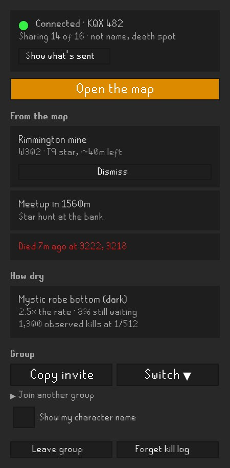 | 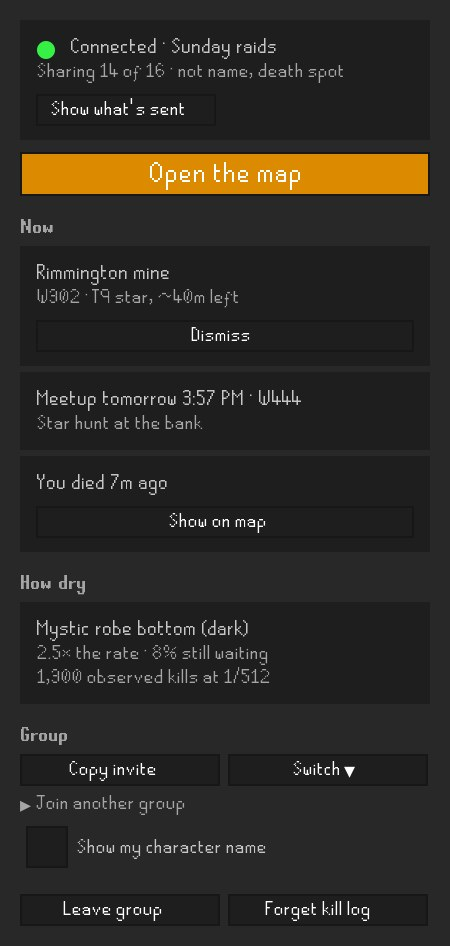 |
| No group yet | 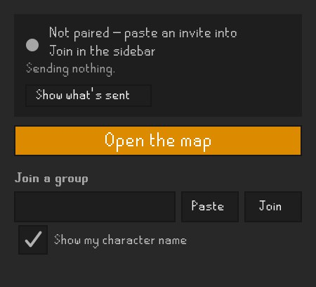 | 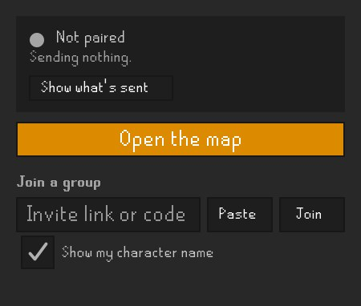 |

| State | Before | As mocked | As built |
| --- | --- | --- | --- |
| Paired, busy | 457px | 473px | 473px |
| No group yet | 204px | 191px | 191px |

- **One loud button.** *Copy invite* and *Switch ▾* were at the default font, as large as **Open
  the map**, so its colour was all that marked it as the one to press. They are small buttons now,
  like every other button that is not it.
- **The group's name on the status line.** *Connected · Sunday raids* once the map has sent a name,
  the code as the line's tooltip, and the code on the line for a group the map has not named. The
  Switch menu still prints both.
- **Meetup times people use.** *Meetup in 1560m* is *Meetup tomorrow 6:42 AM · W444*: minutes under
  an hour and hours and minutes under twelve, as the map's own meetup card counts down, then a day
  and a clock in the player's zone — *today*, *tomorrow*, a weekday within the week and a date past
  it. The world is the one the directive already carried.
- **A death in plain words.** *Died 7m ago at 3222, 3218* in red is *You died 7m ago* in the card's
  ordinary ink, the tile in the tooltip, and **Show on map**, which opens `/map?p=x,y,plane` — the map's
  own grammar for a pinned tile and floor — so its card offers the way back. It is offered whether or not the
  death spot is shared: the tile goes only in the address of the page the press opens, and the
  button's tooltip says so when sharing is off. The heading over the three cards is *Now*, because
  the death is this client's own observation and *From the map* named only two of them.
- **Unpaired, said once.** *Not paired — paste an invite into Join in the sidebar* sat directly
  above the field it pointed at. The status says *Not paired*, and the field says *Invite link or
  code* until something is typed in it.

### Where the plan was wrong

- **The floor.** The mock's tooltip read *3222, 3218, floor 0* for every death. The line now says
  *on floor 1* only when the tile is upstairs, and the tooltip *3222, 3218 (floor 1)*, which is
  what the map's own panel says about the same death.
- **The clock.** The mock wrote *h:mm a* for everybody. The clock follows the player's locale
  between twelve and twenty-four hours, but from a plain pattern rather than the locale's own:
  Java's English short time puts a narrow no-break space before *AM* on a current JDK, and the
  sidebar's font would draw it as a box. `SidebarWordsTest` checks the characters.
- **Later today, and more than a week out.** The mock knew *tomorrow* and weekdays. A meetup twelve
  hours off can be later the same day, which says *today*, and a weekday past six days could be
  either of two weeks, so that is a date.

The pictures are the real panel painted with RuneLite 1.12.39's look and feel, by
`docs/review-evidence/ui-polish-2026-09-30/plugin/PolishShot.java` in `osrs-stars-map`; the
*before* column is the same renderer run on the parent commit.

## Overview and grouped sharing, 11 October 2026

Status: **built**. Overview holds Now, Drop luck — which replaced How dry while this was being
built — and group actions; Sharing holds the existing individual opt-ins behind four group
shortcuts. The connection field sits above both
views when needed. Advanced holds the map address, the snapshot preview and the reset actions.

| Overview | Sharing | Customise | In the client | Advanced |
| --- | --- | --- | --- | --- |
| 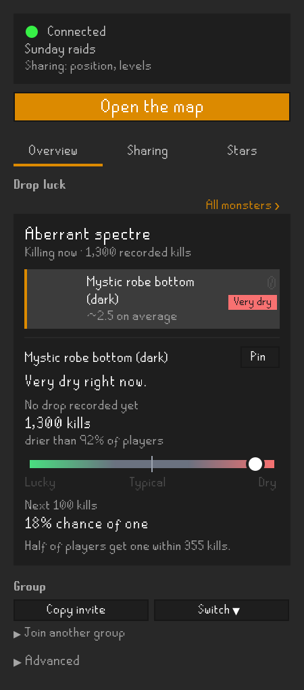 | 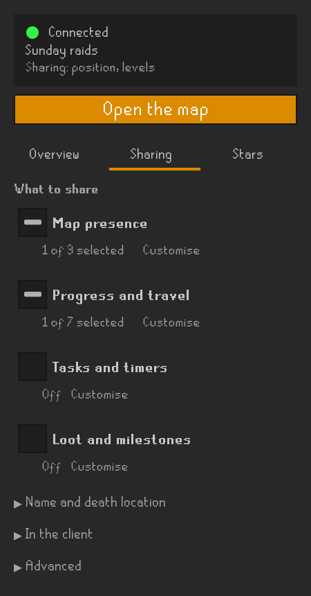 | 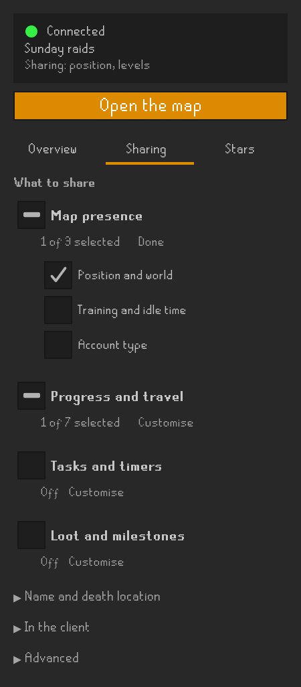 | 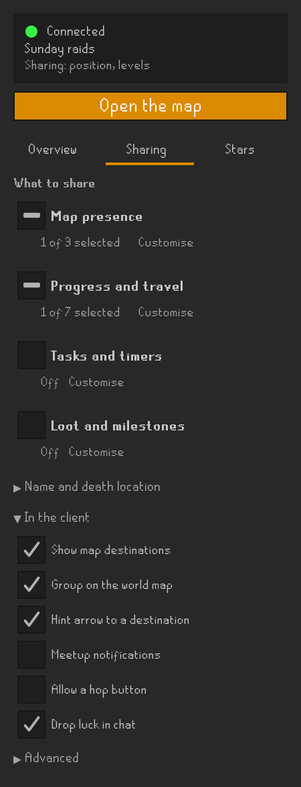 | 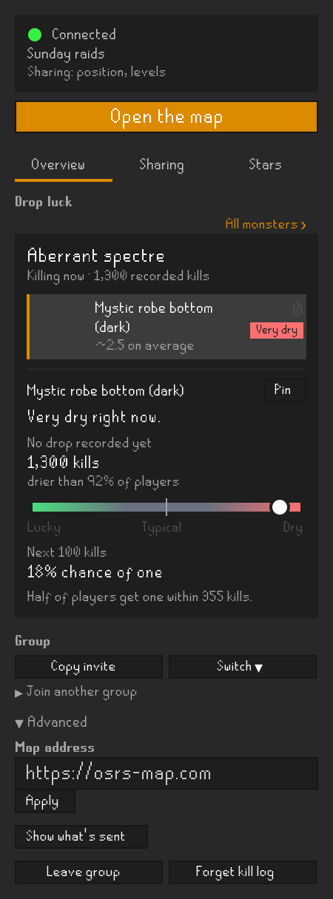 |

The pictures were painted again on 12 October 2026, after Drop luck and the world-map settings
landed; the first set still showed How dry, which made it look as though the plugin had not
changed when the website did.

**A group is a shortcut, not a saved permission.** Selecting it enables only the fields it lists
today, by writing their existing setting keys. A new field in a future version still starts off.
An empty group shows Off, a full group shows All N selected, and a partial group shows a native
dash with N of M selected. Pressing a partial group's checkbox selects its remaining fields;
pressing a full group's checkbox clears them. Customise only opens the individual choices.
The one press at Connect, below, is these shortcuts run once with every group ticked.
Switching tabs preserves both choices and open sections. Hidden Sharing does not reserve its
expanded height in Overview.

Map presence has position/world, activity and account type. Progress and travel has seven
choices, Tasks and timers seven, and Loot and milestones four. Character name and death location
remain separate opt-ins, with the alias in their own fold. Client actions remain separate too;
no sharing group enables destinations, notifications or hopping. Pet and collection additions
still depend on the existing notable-reward switch, explained inside Customise rather than
enabled implicitly. All defaults and native per-setting warning metadata are unchanged.

**Show what's sent stays available under Advanced.** It still uses the actual snapshot builder;
removing its daily button does not remove the way to check what is shared. The first Connect
disclosure still precedes every request to a new server. Choosing data never approves a server
and never repeats the sidebar's IP dialog. The default address remains `https://osrs-map.com`,
with no explanatory line beneath its field.

The photographs paint the real Java panel with RuneLite 1.13.1's own FlatLaf and font at 225px
wide, with PNGs at 2x. Native controls fit in all twelve inspected states: fresh, Overview,
Sharing closed, each of the four Customise sections, name/death, all selected, Advanced, and
busy Overview with and without the manual hop opt-in. These use synthetic local state, with no
game login or connection. Heights include the status and map button:

| State | Height |
| --- | --- |
| Fresh Overview | 221px |
| Paired Overview with Drop luck and group actions | 510px |
| Sharing closed | 430px |
| Map presence Customise | 513px |
| Progress or tasks Customise | 617px |
| Loot Customise | 575px |
| Name and death location open | 516px |
| In the client open | 586px |
| Overview with Advanced open | 608px |
| Busy Overview, destination/meetup/death | 688px |

Drop luck is what made Overview taller: How dry was three lines, and the card that replaced it
shows the monster being killed, its rated drops and the odds on the next hundred kills. Every
other state measures what it did.

The renderer and quiet logger are in `docs/review-evidence/sharing-sidebar-2026-10-11/`.
From the plugin root, reproduce in PowerShell with Java on PATH:

```powershell
.\gradlew.bat harnessJar '-PruneLiteVersion=1.13.1'
$taskEvidence = 'docs/review-evidence/sharing-sidebar-2026-10-11'
$taskClasspath = (Get-Content build/harness/classpath.txt -Raw).Trim()
New-Item -ItemType Directory -Force -Path build/sidebar-shots, build/sidebar-shot-classes | Out-Null
javac -proc:none --release 11 -cp $taskClasspath -d build/sidebar-shot-classes "$taskEvidence/SidebarShot.java"
$taskLogger = (Resolve-Path "$taskEvidence/logback.xml").Path
java '-Djava.awt.headless=true' "-Dlogback.configurationFile=$taskLogger" -cp "build/sidebar-shot-classes;$taskClasspath" com.pbolduc.mapcompanion.SidebarShot build/sidebar-shots
```

On Linux or macOS the same, with `:` between classpath entries (the generated file uses `;`):

```sh
./gradlew harnessJar -PruneLiteVersion=1.13.1
ev=docs/review-evidence/sharing-sidebar-2026-10-11
cp=$(tr ';' ':' < build/harness/classpath.txt | tr -d '\r\n')
mkdir -p build/sidebar-shots build/sidebar-shot-classes
javac -proc:none --release 11 -cp "$cp" -d build/sidebar-shot-classes $ev/SidebarShot.java
java -Djava.awt.headless=true -Dlogback.configurationFile=$PWD/$ev/logback.xml \
  -cp "build/sidebar-shot-classes:$cp" com.pbolduc.mapcompanion.SidebarShot build/sidebar-shots
```

The full Java 11 build passes 341 tests in 56 classes. The added interaction checks cover group
scope, partial selection, external settings changes, tab sizing/state retention, and the
separation between data preferences and connection consent. Existing warning and snapshot
privacy tests still pass. This verifies the native UI and its configuration behaviour; the
logged-in smoke test and Plugin Hub review remain the release checks in the submission guide.

## The Stars tab, 11 October 2026

A third view beside Overview and Sharing: the map's own star list, grouped by landing site with
the worlds underneath and favourites first, filtered with the website's meanings. Expansion and
the selected world belong to this sidebar; filters and favourite sites follow the reader's
paired browser while **Sync filters with website** is on. Mining level and skill total filter
the list here and are never sent for it. Only **Pin destination** and the opt-in **Hop to
world** act, and both only from a press.

**Where the first build was wrong.** It rendered shifted right by half a column with every line
cut off at the right-hand edge, the tier picker reading "…", and the world rows clipped to their
first two columns. BoxLayout lines children up by their alignment point, and the filter row and
site cards were centred among left-aligned labels. Every child of the tab's stacks is now
left-aligned and as wide as the column, the tier picker keeps the width its longest value
needs, and a world row lays its four columns out as components rather than as an HTML table.

Painted the same way as the views above, from the website's own projection of a fixed set of
calls (`src/test/resources/companion-stars.sample.json`). Heights include the status and map
button:

| State | Height |
| --- | --- |
| The list, collapsed | 574px |
| Rimmington mine open, W330 selected | 648px |
| W330 pinned, hopping on | 648px |
| More filters open, a favourite with no star | 786px |

`StarsShot.java` in `docs/review-evidence/stars-tab-2026-10-11/` builds on `SidebarShot`; compile
the two together, after `harnessJar`, with the classpath and logger from the block above:

```powershell
javac -proc:none --release 11 -cp $taskClasspath -d build/stars-shot-classes "$taskEvidence/SidebarShot.java" docs/review-evidence/stars-tab-2026-10-11/StarsShot.java
java '-Djava.awt.headless=true' "-Dlogback.configurationFile=$taskLogger" -cp "build/stars-shot-classes;$taskClasspath" com.pbolduc.mapcompanion.StarsShot build/stars-shots
```

## On the game's world map, 12 October 2026

Status: **built**. What the plugin draws on the world map is one picture, `MapPin`, in four uses:
a friend in their disc's colour with their initials, the same friend faded once they have been
quiet for thirty seconds, the destination in the map's amber, and the next meetup marked M.

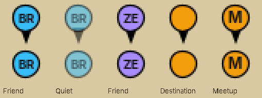

**A pin while its place is in view, a disc on the edge while it is not** (the bottom row). A
point that vanished when the map was panned away said nothing about which way to go, which is
the one thing a destination or a friend somewhere else is for. RuneLite's Party and clue plugins
make the same choice with the same API, so the edge reads the way a player already knows.

**Drawn, not loaded**, for the reason the destination's dot always was: a bundled PNG is one more
artifact for a reviewer. The colours are the website's palette, so a friend is one colour on the
map, in its panel and here. The pin's point fades with the disc; drawn solid under a faded disc it
read as a second, darker marker.

**Settings.** *Show my group on the world map* starts off and is the only thing that asks the map
for anybody's position. *Point the game's arrow at a destination* starts on, and only acts on a
destination the reader already chose to receive or pinned; it never replaces an arrow the game or
another plugin set. Both are in **In the client** above.

The picture is the real `MapPin` at three times its size on the world map's parchment colour,
from `docs/review-evidence/world-map-2026-10-12/PinShot.java`; compile it beside the plugin's own
classes (`build/classes/java/main`) and the harness classpath above. A running client is still the
check for where the pins sit among the game's own icons, and is in the submission guide's list.

## The one press at Connect

Status: **built**, on `claude/where-to-go`, step 9d of `docs/plan-where-to-go-for-a-task.md` in
`osrs-stars-map`, and not yet seen in a real client. Every setting still starts off; the press is
the opt-in.

After the server notice of a first Connect, a card under the connecting line, *Choose what to
share*, with one short row per choice:

- the four groups as bold checkboxes, all ticked; the loot row reads *Loot and milestones · kept
  two weeks*. A partial group shows the dash.
- *Character name*, ticked, and *Where you died*, not.
- *Drawn in this client*: *Show map destinations* and *Group on the world map*, ticked, and under
  them *Opens one connection while you're logged in.*
- *▸ What each one sends*, a fold holding each row's name over what it sends: the groups' fields in
  the Sharing tab's words, *Position and world · Training and idle time · Account type*, naming only
  what is ticked so it always says what the press will send; *Your group keeps the last two
  weeks.* under the loot fields; and the receive stream in full.
- *Sent to osrs-map.com while you're logged in; your group sees it.*, then **Share what's ticked**
  across the card, and *Customise* and *Not now* as links. Customise shows a checkbox per field
  under each row, with the two-weeks line under *Notable drops and levels*; it reads *Fewer
  details* while open.

Ticking anything in the card, Customise and Not now write nothing. The press writes the ticked
settings that are off, the way a group's checkbox does, then folds the card; the status card's
sharing line is the answer. The card follows only a Connect that showed the notice and only while
every choice it offers is still off, and it is never remembered, so an update or a restart never
brings it back. Leaving the group takes it away.

At 225px the card is 443px tall with the fold closed, so the press is in reach without scrolling;
953px with *What each one sends* open and 1,015px with Customise. `WhereToGoShot` paints the three
as `connect`, `connect-fold-open` and `connect-customise`, pointed at a port nothing listens on.

## The way there, step by step

Status: **built**, on `claude/where-to-go`, and not yet seen in a real client. It is steps 5a to 5c
of `docs/plan-where-to-go-for-a-task.md` in `osrs-stars-map`.

- **Under the destination's name**, when the map sent a route: the way being followed and its
  length in run tiles, *Lumbridge Home Teleport · 52 tiles*, then its steps in the card's own words,
  numbered as the website numbers them, each with the detail and notes the card prints under it.
- **The current step** is marked with ▸ and drawn bold and white; the steps behind it go grey. It
  moves on when you stand within four tiles of where it ends, on its floor. Inside a raid's rooms
  nothing moves, because the tile there is not a place.
- **The other ways** fold behind one line, *▸ 2 other ways*, as the card's closed row folds them.
  Pressing one shows its steps instead; the best one says so.
- **Reroute** sits beside **Dismiss**, and plans again from where you stand. While the answer is
  on its way the card says *Planning from where you stand…*, and a refusal is one plain sentence
  under the steps. A route ranked from no position says so above the steps.
- **On the world map** each step's end has a pin with the step's number. The current one is amber
  and holds the map's edge, the ones behind it fade, and the last step leaves the destination's
  own pin uncovered. The game's arrow points at the current step's end once it is loaded.
- **Follow**, beside Reroute while the Shortest Path plugin is running, has it draw each walking
  step as you reach it; it reads **Stop** while following. A line under the steps says when
  Shortest Path is drawing one, *Shortest Path is drawing the walk for step 2.*, so its line on the
  ground is never taken for this plugin's. Reroute follows too, being your own press; a
  destination that merely arrives never does.

### Search, at the top of Overview

Step 6 of the same plan. A box at the top of Overview while connected, as the drop-luck list's own
box is drawn, and under it up to eight places in the website's order, each with the website's
grey line and the effort it measured, *Bank · 2nd floor · ~40 tiles*. An item's sources carry the
website's *Sold at* or *Dropped by* heading, and a name a partial query could mean is a row of its
own, *Item · dropped by 3*. A misspelling is one line, *Did you mean abyssal whip?*, which searches
for it. A pick plans the way and fills the destination's card, so the list folds as soon as one is
pressed; typing or Enter opens it again. One line under the box says *Searching…*, *Planning the
way there…* or the map's refusal.

### Route beside a clue, a death, a star and a meetup

Step 8. Each card under *Now* that names a place gains the way there, planned from where you stand:
**Route back** beside the death's *Show on map*, **Route** on the meetup's card, and a clue card,
*Hard clue* over *Coordinate · dig at 2896, 3119*, whose Route appears when the step names a tile.
In Stars, Route sits beside *Pin destination* for a precise site; an approximate one has **Open on
map** there instead. While the map answers the button reads *Planning…*, and a refusal is one line
under it. The answer fills the destination's card, as a pick from Search does.

### Friends and meetups under Group

Step 9, from `plan-companion-social.md`. Under the Group heading, one card per other member: their
disc in their map colour with presence as a dot in its corner, never as words; *near Lumbridge
Castle · Near you*; their newest news, *Woodcutting 80 · 5m ago*; then **Route** and **Show on map**
for a friend whose position the map draws. A friend sharing no position is a name and a dot. Route
reads *Finding…* while their position is asked for, *Planning…*, then *Reroute*. With the group
layer on, Show on map reads *On the map* and is not pressable.

Then *Meetups*: each with its title, *Today 7:42 PM · in 1h 20m*, *near Lumbridge Castle · W302*,
who is coming as discs (solid for coming or here, a ring for maybe, faint for can't) with *1 here ·
1 coming · 1 maybe*, **Route**, and the four answers in a two-by-two grid with this member's own
filled. *On my way* is one of the four, and Route beside them tells nobody. A map that sends no `events` leaves the one meetup under *Now*,
as before. **Meet here…** opens a form under them: a title, a day of the coming week, an hour and a
minute in fives, defaulting to half an hour from now, and **Make meetup**, which copies the link.

`docs/review-evidence/where-to-go-2026-10-29/WhereToGoShot.java` paints the real panel in each of
these states (steps 5a, 6, 8 and 9) at 225px with made-up names; how to run it is in its docblock.
No picture is committed yet; step 12 takes the README's.
